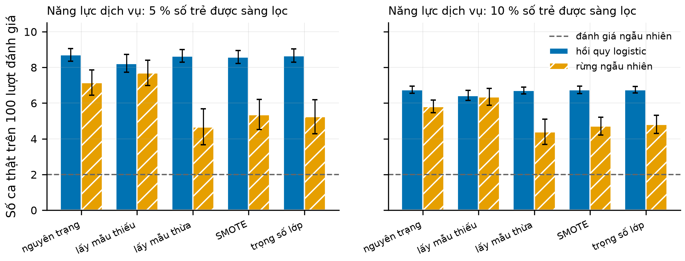

**Tác giả:** [Họ tên tác giả 1]^1,\*^, [Họ tên tác giả 2]^1^, [Họ tên tác giả 3]^2^

^1^ Khoa Công nghệ Thông tin, Trường Đại học Lạc Hồng, Biên Hòa, Đồng Nai

^2^ [Đơn vị công tác — khuyến nghị có một đồng tác giả là nhà tâm lý lâm sàng trẻ em]

^\*^ Tác giả liên hệ: [email]

# TÓM TẮT

Các công cụ số sàng lọc phát triển thường được huấn luyện trên dữ liệu đã "cân bằng lại" — bằng lấy mẫu thiếu, lấy mẫu thừa, SMOTE hoặc trọng số lớp — vì trẻ có rối loạn chỉ chiếm vài phần trăm. Nghiên cứu này hỏi: lựa chọn kỹ thuật đó làm gì với hai thứ mà một dịch vụ tâm lý trẻ em thực sự dùng, là con số nguy cơ được nói với gia đình và danh sách trẻ được chuyển tới đánh giá chuyên sâu? Chúng tôi dùng dữ liệu tổng hợp sinh từ một mô hình trả lời bảng hỏi 20 câu phủ sáu lĩnh vực phát triển (8 554 hồ sơ dương tính, 123 150 hồ sơ âm tính), tỷ lệ mắc cộng đồng 2 %, hồi quy logistic và rừng ngẫu nhiên, năm cách huấn luyện, 20 lần lặp và một quần thể đánh giá độc lập 50 000 trẻ. Huấn luyện sau SMOTE làm xác suất trung bình của hồi quy logistic tăng lên 0,415 (gấp 20,8 lần tỷ lệ thật), đưa 86,0 % số trẻ vào dải "từ 20 % trở lên" trong khi chỉ 23 trên 1 000 trẻ trong dải này thật sự mắc; với quy tắc "chuyển khi nguy cơ từ 5 %", gần như mọi trẻ đều bị chuyển. Khi dịch vụ nhận trẻ theo năng lực (5 % trẻ có điểm cao nhất), tái lấy mẫu không giúp hồi quy logistic và làm rừng ngẫu nhiên tìm được ít ca thật hơn — 5,4 so với 7,1 ca thật trên 100 lượt đánh giá — ngoại trừ lấy mẫu thiếu. Hai phép sửa thang không cần nhãn — hiệu chỉnh tiên nghiệm và "khớp trung bình" theo tỷ lệ mắc đã biết — khôi phục gần trọn vẹn hồi quy logistic (sai số hiệu chỉnh kỳ vọng 2,1–2,9 phần nghìn), nhưng không sửa được rừng ngẫu nhiên sau lấy mẫu thừa, SMOTE hay trọng số lớp, vì ở đó thang bị biến dạng về hình dạng (hệ số góc hiệu chỉnh 0,29–0,42). Cập nhật trên 100–200 hồ sơ có nhãn tại chỗ kém hơn khớp trung bình theo tỷ lệ mắc đã biết. Chúng tôi đề xuất sáu câu hỏi dịch vụ tâm lý nên đặt cho nhà cung cấp công cụ và phát hành một công cụ mã nguồn mở kiểm tra đầu ra trước khi triển khai. Mọi kết quả thu được trên dữ liệu tổng hợp và cần được kiểm chứng trên dữ liệu thực địa.

**Từ khóa:** tâm lý lâm sàng trẻ em; công cụ số hỗ trợ quyết định; mất cân bằng lớp; truyền đạt nguy cơ; năng lực dịch vụ.

# ABSTRACT

**When a screening tool is trained on "rebalanced" data: How class-imbalance handling changes the risk figure told to families and the waiting list of a psychological service — a study on synthetic data.** Digital developmental screening tools are often trained on rebalanced data (under-sampling, over-sampling, SMOTE or class weights) because affected children are a small minority. Using synthetic questionnaire data (20 items, six developmental domains), a community prevalence of 2%, logistic regression and random forest, five training strategies, 20 replications and an independent population of 50,000 children, we examined what these choices do to the risk figure communicated to families and to the list of children referred for specialist assessment. Training after SMOTE raised the mean predicted risk of logistic regression about twentyfold and placed 86% of children in a "20% or higher" band whose true rate was about 2%; a "refer at 5% risk" rule then referred virtually every child. When the service admitted a fixed 5% of children with the highest scores, rebalancing did not help logistic regression and reduced the yield of random forest, except under-sampling. Two label-free repairs — analytical prior correction and "mean matching" to a known prevalence — almost fully restored logistic regression but not random forest after over-sampling, SMOTE or class weighting, where the distortion affected the shape of the risk scale (calibration slope 0.3–0.4). Updating on 100–200 local labelled records was worse than mean matching to a known prevalence. We propose six questions a psychological service should ask a tool vendor and release an open-source audit tool. All findings come from synthetic data and require field validation.

# 1. ĐẶT VẤN ĐỀ

## 1.1. Công cụ số trong chuỗi chăm sóc tâm lý trẻ em

Sàng lọc phát triển là cửa ngõ của chuỗi chăm sóc: bảng hỏi được điền ở cộng đồng hoặc cơ sở y tế ban đầu, trẻ có kết quả đáng lo ngại được chuyển tới nhà tâm lý hoặc nhóm đa chuyên ngành để đánh giá chuyên sâu, và chỉ sau đánh giá đó mới có chẩn đoán và can thiệp (Hyman và cs., 2020). Ở Việt Nam, bộ công cụ phát hiện sớm rối loạn phổ tự kỷ đã được Bộ Y tế ban hành (Bộ Y tế, 2021), và các ứng dụng số ngày càng được dùng để chấm điểm, lưu trữ và gợi ý chuyển tuyến. Trong tâm lý học, xu hướng này nằm trong trào lưu rộng hơn của chăm sóc dựa trên đo lường và tâm thần học số (Lewis và cs., 2019; Torous và cs., 2021): công cụ không thay nhà lâm sàng mà cung cấp thông tin cho các quyết định của họ, và từ lâu đã có bằng chứng rằng dự báo có cấu trúc thường ít nhất ngang bằng phán đoán không hỗ trợ (Grove và cs., 2000). Nhưng một hệ hỗ trợ quyết định chỉ có ích khi đầu ra của nó được đọc đúng nghĩa (Sutton và cs., 2020).

Đầu ra của một công cụ sàng lọc được dùng theo hai cách, và hai cách này đòi hỏi hai phẩm chất khác nhau. Cách thứ nhất là **nói với gia đình**: nhà tâm lý hoặc cán bộ y tế đọc một con số hay một mức nguy cơ, và cha mẹ hiểu nó như xác suất con mình có rối loạn. Truyền đạt nguy cơ đúng nghĩa là một kỹ năng lâm sàng có cơ sở bằng chứng (Zipkin và cs., 2014; Spiegelhalter, 2017); nó chỉ khả thi nếu con số trên màn hình thật sự là một xác suất — tức là **được hiệu chỉnh** (Van Calster và cs., 2019). Cách thứ hai là **xếp danh sách chờ**: dịch vụ tâm lý có năng lực đánh giá hữu hạn, và công cụ quyết định trẻ nào được ưu tiên. Cách này chủ yếu cần công cụ **xếp đúng thứ tự** các trẻ, và — nếu việc chuyển được quyết định bằng một ngưỡng nguy cơ — cần ngưỡng đó mang đúng nghĩa để số trẻ bị chuyển khớp với năng lực của dịch vụ.

## 1.2. Mất cân bằng lớp và thói quen "cân bằng lại" dữ liệu

Trong cộng đồng, trẻ có rối loạn phổ tự kỷ chiếm khoảng 1 % (Zeidan và cs., 2022), và tỷ lệ dương của các bảng hỏi sàng lọc chỉ vài phần trăm (Robins và cs., 2014; Aishworiya và cs., 2023). Trong tài liệu học máy, tình huống này được gọi là **mất cân bằng lớp**, và phản xạ phổ biến là "cân bằng lại" tập huấn luyện: lấy mẫu thiếu lớp đa số, lấy mẫu thừa lớp thiểu số, sinh mẫu thiểu số nhân tạo bằng SMOTE (Chawla và cs., 2002), hoặc gán trọng số lớn cho lớp thiểu số (He và Garcia, 2009; Fernández và cs., 2018). Một nghiên cứu thực địa gần đây trên 3 639 trẻ Việt Nam dùng M-CHAT-R bản tiếng Việt báo cáo rừng ngẫu nhiên kết hợp SMOTE đạt AUC 0,983 nhưng độ chính xác dương (precision) chỉ 0,351 ở tỷ lệ mắc khoảng 2 % (Vo và cs., 2026) — một minh họa rằng một chỉ số xếp hạng rất cao vẫn có thể đi kèm một tỷ lệ báo động nhầm đáng kể.

Y văn thống kê y học đã chỉ ra rằng các phép "sửa mất cân bằng" làm hỏng hiệu chỉnh xác suất mà thường không cải thiện năng lực phân biệt, với hồi quy logistic (van den Goorbergh và cs., 2022) và với các mô hình học máy (Carriero và cs., 2025). Về mặt lý thuyết, cân bằng lại tập huấn luyện tương đương với thay đổi xác suất tiên nghiệm, và có thể bù lại bằng công thức Bayes nếu biết tỷ lệ gốc (Elkan, 2001; Saerens và cs., 2002; Dal Pozzolo và cs., 2015). Tuy vậy, các kết quả này được viết bằng ngôn ngữ của nhà thống kê — điểm Brier, hệ số góc hiệu chỉnh, AUC — chứ không bằng ngôn ngữ của một dịch vụ tâm lý: bao nhiêu gia đình sẽ nghe một con số nguy cơ bị thổi phồng, danh sách chờ sẽ dài thêm bao nhiêu, và bao nhiêu trẻ mắc thật sẽ không được ưu tiên. Khi một bệnh viện hay trung tâm can thiệp **mua** hoặc **nhận** một công cụ, họ thường không kiểm soát được cách công cụ đã được huấn luyện; họ chỉ thấy đầu ra. Câu hỏi thực hành vì vậy là: **nhìn đầu ra, dịch vụ có nhận ra và sửa được hậu quả của việc cân bằng lại hay không?**

## 1.3. Mục tiêu

Nghiên cứu mô phỏng này trả lời ba câu hỏi, đặt trong bối cảnh một dịch vụ tâm lý nhận trẻ từ sàng lọc cộng đồng với tỷ lệ mắc 2 %:

1. **Con số nói với gia đình.** Cân bằng lại dữ liệu huấn luyện làm thay đổi thế nào tỷ lệ trẻ bị xếp vào mỗi dải nguy cơ, và dải đó còn trung thực không?
2. **Danh sách chờ.** Khi dịch vụ nhận trẻ theo năng lực cố định, cân bằng lại có giúp tìm được nhiều ca thật hơn không? Khi dịch vụ nhận trẻ theo một ngưỡng nguy cơ, bao nhiêu trẻ bị chuyển và lợi ích ròng của quyết định thay đổi ra sao?
3. **Kiểm tra và sửa trước khi dùng.** Khi nhà cung cấp đã cân bằng lại, dịch vụ có thể sửa thang nguy cơ mà không cần — hoặc chỉ cần ít — dữ liệu có nhãn tại chỗ không, và khi nào thì không sửa được?

Nghiên cứu đi kèm một bộ lưới đầy đủ hơn (bảy cách xử lý × bốn mô hình × bốn tỷ lệ mắc) được báo cáo riêng cho độc giả phương pháp học ([Tác giả], 2026a; [Tác giả], 2026b); ở đây chúng tôi chỉ tóm tắt lưới đó (mục 3.1) và tập trung vào ba phân tích mới hướng tới người dùng lâm sàng.

# 2. PHƯƠNG PHÁP

Thiết kế mô phỏng được mô tả theo khung ADEMP (mục tiêu, cơ chế sinh dữ liệu, đại lượng ước lượng, phương pháp, chỉ số đánh giá) (Morris và cs., 2019); báo cáo tuân theo các mục liên quan của TRIPOD+AI (Collins và cs., 2024). Nghiên cứu **không dùng dữ liệu của trẻ thật** nên không cần phê duyệt đạo đức.

## 2.1. Dữ liệu tổng hợp

Dữ liệu được sinh bằng bộ mô phỏng của một hệ sàng lọc lai luật – học máy đang được phát triển (Nguyễn, 2026). Bộ sinh mô phỏng câu trả lời của cha mẹ cho một bảng hỏi 20 câu phủ sáu lĩnh vực phát triển (giao tiếp – ngôn ngữ, vận động thô, vận động tinh, bắt chước – học, cá nhân – xã hội, hành vi bất thường), có mức bỏ trống và nhiễu trả lời. Mỗi hồ sơ được tóm thành sáu điểm nguy cơ theo lĩnh vực trên thang 0–1 bằng tầng suy diễn mờ của hệ; sáu điểm này là đầu vào của các mô hình. Chúng tôi sinh riêng một kho hồ sơ dương tính (14 000 hồ sơ) và một kho âm tính (200 000 hồ sơ); sau khi loại hồ sơ bỏ trống quá 30 % số câu hoặc thiếu điểm lĩnh vực theo đúng quy tắc từ chối của công cụ, còn 8 554 và 123 150 hồ sơ. Mỗi kho được chia đôi cố định thành phần **phát triển** (dùng để huấn luyện: 4 277 dương, 61 575 âm) và phần **triển khai** (dùng để đánh giá). Vì bộ sinh chỉ dùng tỷ lệ mắc ở bước gán nhãn, rút lại từ hai kho theo một tỷ lệ bất kỳ cho đúng phân phối của quần thể ở tỷ lệ đó. Kho hồ sơ giống hệt kho của nghiên cứu đi kèm (dấu vân tay SHA-256 `ab3c60d495f1…`).

**Quần thể triển khai.** Từ phần triển khai, chúng tôi rút cố định một quần thể 50 000 trẻ với đúng 1 000 trẻ mắc (2 %) — đóng vai toàn bộ trẻ được sàng lọc trong một năm ở một địa bàn. Phần còn lại của phần triển khai (3 277 dương, 12 575 âm) chỉ dùng để rút các **mẫu kiểm tra có nhãn** ở mục 2.5, nên không hồ sơ nào vừa được dùng để sửa thang vừa được dùng để đánh giá.

## 2.2. Mô hình và năm cách huấn luyện

Ở mỗi lần lặp, một tập huấn luyện 5 000 hồ sơ với tỷ lệ mắc 2 % (100 trẻ mắc) được rút ngẫu nhiên từ phần phát triển. Hai mô hình phổ biến nhất trong y văn sàng lọc bằng học máy được huấn luyện: **hồi quy logistic** (phạt L2, C = 1) và **rừng ngẫu nhiên** (Breiman, 2001) (200 cây, tối thiểu 5 hồ sơ mỗi lá). Mỗi mô hình được huấn luyện theo năm cách: (i) **nguyên trạng** — dùng dữ liệu như thu thập; (ii) **lấy mẫu thiếu** — bỏ ngẫu nhiên trẻ không mắc đến khi hai lớp bằng nhau (còn 100 + 100 hồ sơ); (iii) **lấy mẫu thừa** — nhân bản ngẫu nhiên trẻ mắc đến khi hai lớp bằng nhau; (iv) **SMOTE** — sinh trẻ mắc nhân tạo bằng nội suy tới một trong năm láng giềng gần nhất cùng lớp (Chawla và cs., 2002); (v) **trọng số lớp** — mỗi lớp nhận tổng trọng số bằng nhau. Bốn cách cuối đều đưa tỷ lệ "hiệu dụng" của lớp mắc trong tập huấn luyện lên 50 %.

## 2.3. Hai cách vận hành dịch vụ

**Theo năng lực.** Dịch vụ chỉ đánh giá được K % số trẻ được sàng lọc (K = 2, 5 hoặc 10 %) và nhận K % trẻ có điểm cao nhất. Cách này chỉ dùng **thứ hạng** nên không phụ thuộc thang điểm. Chỉ số là **số ca thật trên 100 lượt đánh giá** (giá trị dự báo dương ở mức năng lực K) và độ nhạy — tỷ lệ trẻ mắc được đưa vào danh sách. Khi nhiều trẻ trùng điểm ở ranh giới năng lực, chúng tôi tính kỳ vọng của việc bốc thăm ngẫu nhiên trong nhóm trùng điểm. Mốc so sánh là đánh giá ngẫu nhiên: 2 ca thật trên 100 lượt.

**Theo ngưỡng nguy cơ.** Trẻ được chuyển khi nguy cơ hiển thị từ ngưỡng $p_t$ trở lên, $p_t \in \{2, 5, 10\,\%\}$. Ngưỡng mã hóa đánh đổi mà dịch vụ chấp nhận: chọn $p_t = 5\,\%$ nghĩa là chấp nhận đánh giá tối đa 19 trẻ không mắc để phát hiện một trẻ mắc (Wynants và cs., 2019). Chúng tôi báo cáo tỷ lệ trẻ bị chuyển — thước đo trực tiếp của **tải** lên danh sách chờ — và lợi ích ròng theo phân tích đường cong quyết định (Vickers và Elkin, 2006; Vickers và cs., 2016):

$$\mathrm{NB}(p_t) = \frac{\mathrm{TP}}{n} - \frac{\mathrm{FP}}{n} \cdot \frac{p_t}{1 - p_t}, \qquad (1)$$

với TP và FP là số trẻ được chuyển có và không có rối loạn, $n$ là số trẻ được sàng lọc. Hai chiến lược tham chiếu là "không chuyển ai" (NB = 0) và "chuyển tất cả" (NB = $\pi - (1-\pi)\,p_t/(1-p_t)$, với $\pi = 0{,}02$; bằng đúng 0 khi $p_t = 2\,\%$). Một quy tắc chỉ có giá trị ở ngưỡng $p_t$ nếu lợi ích ròng của nó vượt cả hai chiến lược tham chiếu.

## 2.4. Con số nói với gia đình

Để mô phỏng cách trao đổi kết quả, nguy cơ được chia thành bốn dải: dưới 1 %, 1–5 %, 5–20 % và từ 20 % trở lên — một quy ước minh họa của nghiên cứu, không phải chuẩn lâm sàng. Với mỗi cách huấn luyện, chúng tôi đo tỷ trọng trẻ trong mỗi dải và tỷ lệ mắc thật trong dải, viết dưới dạng tần suất tự nhiên "trên 1 000 trẻ" vốn dễ hiểu hơn xác suất có điều kiện đối với cả nhà chuyên môn lẫn gia đình (Gigerenzer và Hoffrage, 1995). Một dải là trung thực nếu số trẻ mắc thật trên 1 000 nằm trong khoảng mà tên dải hứa hẹn.

## 2.5. Kiểm tra và sửa thang trước khi triển khai

Chúng tôi giả định dịch vụ nhận một mô hình đã huấn luyện xong và so sánh năm cách xử lý đầu ra $p$ của nó. Kí hiệu $\sigma(z) = 1/(1+e^{-z})$ và $\mathrm{logit}(p) = \ln[p/(1-p)]$.

(a) **Dùng nguyên xác suất** của mô hình.

(b) **Hiệu chỉnh tiên nghiệm** (Elkan, 2001; Saerens và cs., 2002). Nếu nhà cung cấp khai báo tỷ lệ mắc gốc $\pi$ của tập huấn luyện và tỷ lệ sau cân bằng $\pi_s$ (ở đây 0,5), xác suất được đổi về tỷ lệ gốc bằng công thức Bayes

$$p' = \frac{p\,\pi/\pi_s}{p\,\pi/\pi_s + (1-p)(1-\pi)/(1-\pi_s)}. \qquad (2)$$

Công thức (2) đúng khi việc cân bằng lại chỉ làm dịch xác suất tiên nghiệm và mô hình ước lượng đúng xác suất có điều kiện dưới tỷ lệ $\pi_s$. Nó không cần nhãn nhưng cần thông tin mà nhà cung cấp thường không công bố.

(c) **Khớp trung bình** (không cần nhãn, không cần thông tin từ nhà cung cấp). Dịch vụ chạy công cụ trên chính quần thể trẻ của mình (không cần biết trẻ nào mắc) và chọn một độ dịch log-odds $\delta$ sao cho nguy cơ trung bình bằng tỷ lệ mắc $\hat\pi$ mà dịch vụ ước tính từ số liệu dịch tễ:

$$\frac{1}{n}\sum_{i=1}^{n} \sigma\big(\mathrm{logit}(p_i) + \delta\big) = \hat\pi, \qquad p_i' = \sigma\big(\mathrm{logit}(p_i) + \delta\big). \qquad (3)$$

Để đo hậu quả của ước tính sai tỷ lệ mắc, chúng tôi dùng $\hat\pi$ = 2 % (đúng), 1 % và 4 % (sai gấp đôi theo hai chiều).

(d) **Cập nhật hệ số chặn** trên $n$ hồ sơ có nhãn tại chỗ (Steyerberg và cs., 2004; Janssen và cs., 2008): như (3) nhưng $\delta$ được chọn sao cho tổng nguy cơ bằng số trẻ mắc quan sát trong mẫu — đây chính là ước lượng hợp lý cực đại của hệ số chặn khi giữ nguyên hệ số góc.

(e) **Khớp lại Platt** trên cùng $n$ hồ sơ: hồi quy logistic của nhãn theo $\mathrm{logit}(p)$ (phạt L2 mặc định), học cả hệ số chặn và hệ số góc.

Mẫu có nhãn gồm $n \in \{100, 200, 500\}$ hồ sơ rút từ phần triển khai dành riêng, số trẻ mắc ngẫu nhiên theo phân phối nhị thức (trung bình 1,9, 3,4 và 9,7 trẻ mắc), như khi dịch vụ lấy $n$ hồ sơ liên tiếp đã có kết quả đánh giá chuyên sâu. Các phép (b)–(d) là biến đổi tăng nghiêm ngặt nên **không đổi thứ hạng**; kết quả ở chế độ năng lực vì vậy không phụ thuộc cách sửa.

## 2.6. Chỉ số và phân tích thống kê

**Nguy cơ trung bình** so với tỷ lệ mắc thật đo độ lệch tổng thể — tầng thấp nhất của phân cấp hiệu chỉnh (Van Calster và cs., 2016). **Sai số hiệu chỉnh kỳ vọng** (ECE) chia quần thể thành 10 nhóm theo phân vị của nguy cơ và lấy trung bình có trọng số của độ lệch giữa nguy cơ trung bình và tỷ lệ mắc quan sát trong mỗi nhóm. **Hệ số góc hiệu chỉnh** là hệ số của $\mathrm{logit}(p)$ trong hồi quy logistic không phạt của nhãn theo $\mathrm{logit}(p)$; giá trị 1 là lý tưởng, nhỏ hơn 1 nghĩa là nguy cơ **quá phân tán** (quá cao ở trẻ điểm cao và quá thấp ở trẻ điểm thấp) — một biến dạng về **hình dạng** mà không phép dịch nào sửa được. **Điểm Brier** (Brier, 1950) và PR-AUC (diện tích dưới đường cong độ chính xác – độ nhạy) được dùng ở lưới chính.

Mọi chỉ số là trung bình qua 20 lần lặp; mỗi lần lặp rút lại tập huấn luyện và các mẫu có nhãn, còn quần thể triển khai giữ cố định. Với mỗi mô hình, chúng tôi so sánh từng cách huấn luyện (và từng cách sửa thang) với cách nguyên trạng bằng hiệu số ghép cặp theo lần lặp và kiểm định t một mẫu. Họ phép kiểm gồm 108 so sánh (số ca thật trên 100 lượt ở ba mức năng lực; lợi ích ròng của đầu ra thô, sau hiệu chỉnh tiên nghiệm và sau khớp trung bình ở ba ngưỡng), được hiệu chỉnh so sánh bội bằng thủ tục Benjamini–Hochberg ở mức tỷ lệ phát hiện sai 0,05 (Benjamini và Hochberg, 1995); họ này có giữ 6 so sánh tầm thường (hiệu chỉnh tiên nghiệm của mô hình nguyên trạng là phép đồng nhất), làm thủ tục bảo thủ hơn một chút. Hạt giống ngẫu nhiên được cố định và ghi lại cùng dấu vân tay của mã nguồn; chạy lại cho kết quả trùng từng byte (mục Dữ liệu và mã nguồn).

## 2.7. Công cụ kiểm tra đầu ra

Từ kết quả của mục 2.5, chúng tôi viết một công cụ dòng lệnh chỉ phụ thuộc thư viện numpy. Đầu vào là tệp CSV điểm của công cụ sàng lọc trên các trẻ tại chỗ (có hoặc không có nhãn), tỷ lệ mắc ước tính và năng lực của dịch vụ. Công cụ báo: (1) **hệ số thổi phồng** — nguy cơ trung bình chia cho tỷ lệ mắc, cảnh báo khi vượt 1,5; (2) tỷ lệ trẻ bị chuyển ở mỗi ngưỡng, so với năng lực; (3) điểm cắt tương ứng với năng lực và số trẻ trùng điểm ở ranh giới; (4) thang sau khớp trung bình (hoặc hiệu chỉnh tiên nghiệm nếu có thông tin từ nhà cung cấp) và bảng dải nguy cơ trước – sau; (5) nếu có nhãn: tỷ lệ mắc quan sát kèm khoảng tin cậy Wilson 95 %, hệ số góc hiệu chỉnh (chỉ khi có ít nhất 10 trẻ mắc) và lợi ích ròng trước – sau. Các ngưỡng cảnh báo là quy ước rút ra từ mô phỏng, không phải chuẩn lâm sàng.

# 3. KẾT QUẢ

## 3.1. Lưới chính: cân bằng lại hầu như không giúp phân biệt nhưng luôn làm hỏng xác suất

Bảng 1 tóm tắt lưới chính của nghiên cứu đi kèm ở tỷ lệ mắc 2 % (20 lần lặp, tập kiểm thử 50 000 hồ sơ mỗi tỷ lệ; 176 cấu hình, 256 phép kiểm có hiệu chỉnh Benjamini–Hochberg). Trên cả bốn tỷ lệ mắc và bốn mô hình, bốn cách cân bằng lại làm điểm Brier xấu đi có ý nghĩa ở 64/64 ô. PR-AUC chỉ tăng có ý nghĩa ở 12/64 ô — tất cả thuộc Fuzzy k-NN (một mô hình gần như không phân biệt được trên dữ liệu này) hoặc rừng ngẫu nhiên với lấy mẫu thiếu, mức tăng lớn nhất 13,2 phần nghìn — và giảm có ý nghĩa ở 36 ô. Lợi ích ròng ở ngưỡng 2 % giảm có ý nghĩa ở 32/64 ô và tăng ở 13 ô, chủ yếu ở Fuzzy k-NN và ở tỷ lệ mắc 5 %, nơi "chuyển tất cả" đã là chiến lược tốt ở ngưỡng 2 %. Hồi quy logistic và mô hình lai huấn luyện sau cân bằng lại gắn cờ gần như mọi trẻ ở cả bốn tỷ lệ mắc.

**Bảng 1.** *Lưới chính ở tỷ lệ mắc 2 %: PR-AUC, điểm Brier, tỷ lệ trẻ bị chuyển và lợi ích ròng với quy tắc "chuyển khi nguy cơ ≥ 2 %". Dịch chuyển ngưỡng dùng đúng mô hình nguyên trạng, chỉ chọn lại điểm cắt trên một tập hiệu chỉnh 2 000 hồ sơ, nên PR-AUC và Brier của nó trùng với nguyên trạng theo xây dựng. Trung bình 20 lần lặp. Mốc: Brier của dự báo hằng số 0,02 là 19,6 phần nghìn; PR-AUC của dự báo ngẫu nhiên là 20 phần nghìn.*

| Mô hình | Cách huấn luyện | PR-AUC ×1 000 | Brier ×1 000 | Tỷ lệ trẻ bị chuyển | Lợi ích ròng ×1 000 |
|:--------------------|:------------------|:----------:|:----------:|:----------:|:----------:|
| Hồi quy logistic | Nguyên trạng | 60,7 | 19,2 | 33,0 % | 6,59 |
|  | Lấy mẫu thiếu | 56,3 | 215,2 | 100,0 % | 0,00 |
|  | SMOTE | 59,7 | 205,4 | 100,0 % | 0,00 |
|  | Dịch chuyển ngưỡng | 60,7 | 19,2 | 37,5 % | 6,23 |
| Rừng ngẫu nhiên | Nguyên trạng | 48,3 | 19,6 | 31,0 % | 5,56 |
|  | Lấy mẫu thiếu | 53,1 | 215,2 | 100,0 % | 0,00 |
|  | SMOTE | 38,1 | 46,2 | 65,2 % | 4,00 |
|  | Dịch chuyển ngưỡng | 48,3 | 19,6 | 33,7 % | 5,17 |
| Fuzzy k-NN | Nguyên trạng | 22,0 | 28,3 | 4,7 % | 0,97 |
|  | Lấy mẫu thiếu | 28,4 | 293,5 | 72,8 % | 2,59 |
|  | SMOTE | 23,9 | 77,8 | 12,8 % | 1,86 |
|  | Dịch chuyển ngưỡng | 22,0 | 28,3 | 3,1 % | 0,69 |
| Mô hình lai ba nhánh | Nguyên trạng | 40,4 | 55,7 | 100,0 % | 0,00 |
|  | Lấy mẫu thiếu | 40,4 | 172,9 | 100,0 % | 0,00 |
|  | SMOTE | 38,1 | 102,8 | 100,0 % | 0,00 |
|  | Dịch chuyển ngưỡng | 40,4 | 55,7 | 37,2 % | 5,18 |

Phần còn lại của mục Kết quả đi sâu vào hồi quy logistic và rừng ngẫu nhiên — hai mô hình có năng lực phân biệt thực (AUC khoảng 0,69–0,73) và phổ biến nhất trong thực hành.

## 3.2. Con số nói với gia đình

Cân bằng lại làm nguy cơ trung bình của hồi quy logistic tăng lên 22,1 lần (lấy mẫu thiếu), 21,0 lần (lấy mẫu thừa), 20,8 lần (SMOTE) và 21,0 lần (trọng số lớp) so với tỷ lệ mắc thật; với rừng ngẫu nhiên, hệ số tương ứng là 21,7, 5,2, 5,4 và 8,8. Bảng 2 và Hình 1 chuyển điều này sang ngôn ngữ tư vấn.

**Bảng 2.** *Hồi quy logistic, tỷ lệ mắc 2 %: số trẻ trên 1 000 được xếp vào mỗi dải nguy cơ và số trẻ trên 1 000 trong dải đó thật sự có rối loạn. Trung bình 20 lần lặp trên quần thể 50 000 trẻ; "—": không có trẻ nào trong dải.*

| Dải nguy cơ | Trẻ/1 000 (nguyên trạng) | Mắc thật/1 000 (nguyên trạng) | Trẻ/1 000 (SMOTE, thô) | Mắc thật/1 000 (SMOTE, thô) | Trẻ/1 000 (SMOTE + khớp TB) | Mắc thật/1 000 (SMOTE + khớp TB) |
|:----------------|:--------:|:--------:|:--------:|:--------:|:--------:|:--------:|
| Dưới 1 % | 285 | 5 | 0 | — | 413 | 7 |
| 1–5 % | 657 | 21 | 0 | — | 511 | 23 |
| 5–20 % | 58 | 83 | 140 | 4 | 73 | 72 |
| Từ 20 % trở lên | 0 | — | 860 | 23 | 3 | 164 |

{width=16cm}

Ở cột nguyên trạng, các dải trung thực: trong 1 000 trẻ được báo "1–5 %", khoảng 21 trẻ mắc, và trong 1 000 trẻ ở dải "5–20 %", khoảng 83 trẻ. Sau SMOTE, cứ 1 000 trẻ được sàng lọc thì 860 trẻ bị báo "từ 20 % trở lên", nhưng tỷ lệ mắc thật trong nhóm đó (23/1 000) gần như bằng tỷ lệ mắc của cả cộng đồng. Nói cách khác, dải nguy cơ "cao" không còn chứa thông tin gì về đứa trẻ cụ thể, nhưng vẫn truyền tới gia đình một thông điệp đáng lo ngại. Khớp trung bình theo tỷ lệ 2 % (cột cuối) đưa phân bố dải về gần cột nguyên trạng.

## 3.3. Dịch vụ theo năng lực: cân bằng lại không giúp tìm thêm ca thật

Khi dịch vụ nhận K % trẻ điểm cao nhất, hồi quy logistic nguyên trạng tìm được 8,70 ca thật trên 100 lượt đánh giá ở K = 5 % — gấp 4,4 lần đánh giá ngẫu nhiên (Bảng 3, Hình 2). Lấy mẫu thừa, SMOTE và trọng số lớp không làm thay đổi có ý nghĩa con số này (9/9 so sánh không có ý nghĩa sau hiệu chỉnh bội); lấy mẫu thiếu làm nó giảm nhẹ nhưng có ý nghĩa (q ≤ 0,015), vì mô hình chỉ còn 200 hồ sơ để học. Với rừng ngẫu nhiên, lấy mẫu thừa, SMOTE và trọng số lớp làm **giảm** số ca thật trên 100 lượt ở mọi mức năng lực (9/9 so sánh có ý nghĩa), từ 1,8 đến 2,5 ca ở K = 5 %. Quy về 10 000 trẻ được sàng lọc, với cùng 500 lượt đánh giá, SMOTE làm dịch vụ bỏ lỡ thêm khoảng 9 trẻ mắc. Ngoại lệ duy nhất là lấy mẫu thiếu với rừng ngẫu nhiên, tăng từ 7,15 lên 7,70 ca ở K = 5 % (q = 0,004): mỗi cây học trên một tập nhỏ, cân bằng hơn, và rừng ít học thuộc hơn — một cơ chế điều chuẩn, không phải lợi ích riêng của "cân bằng".

**Bảng 3.** *Số ca thật trên 100 lượt đánh giá (trung bình ± độ lệch chuẩn qua 20 lần lặp) khi dịch vụ nhận K % trẻ có điểm cao nhất, và độ nhạy ở K = 5 %. \*: khác nguyên trạng có ý nghĩa sau hiệu chỉnh Benjamini–Hochberg. Mốc: đánh giá ngẫu nhiên cho 2 ca thật trên 100 lượt.*

| Mô hình | Cách huấn luyện | K = 2 % | K = 5 % | K = 10 % | Độ nhạy ở K = 5 % |
|:------------------|:----------------|:------------:|:------------:|:------------:|:------------:|
| Hồi quy logistic | Nguyên trạng | 11,82 ± 0,64 | 8,70 ± 0,35 | 6,76 ± 0,20 | 21,8 % |
|  | Lấy mẫu thiếu | 11,20 ± 1,00\* | 8,23 ± 0,49\* | 6,43 ± 0,28\* | 20,6 % |
|  | Lấy mẫu thừa | 11,69 ± 0,80 | 8,65 ± 0,35 | 6,71 ± 0,19 | 21,6 % |
|  | SMOTE | 11,74 ± 0,69 | 8,58 ± 0,36 | 6,74 ± 0,21 | 21,5 % |
|  | Trọng số lớp | 11,75 ± 0,71 | 8,66 ± 0,38 | 6,75 ± 0,19 | 21,7 % |
| Rừng ngẫu nhiên | Nguyên trạng | 9,10 ± 1,02 | 7,15 ± 0,71 | 5,82 ± 0,35 | 17,9 % |
|  | Lấy mẫu thiếu | 9,15 ± 1,41 | 7,70 ± 0,71\* | 6,35 ± 0,47\* | 19,2 % |
|  | Lấy mẫu thừa | 4,33 ± 1,23\* | 4,67 ± 1,00\* | 4,40 ± 0,70\* | 11,7 % |
|  | SMOTE | 5,85 ± 1,10\* | 5,36 ± 0,85\* | 4,71 ± 0,49\* | 13,4 % |
|  | Trọng số lớp | 5,52 ± 1,46\* | 5,24 ± 0,95\* | 4,82 ± 0,51\* | 13,1 % |

{width=16cm}

## 3.4. Dịch vụ theo ngưỡng nguy cơ: danh sách chờ bùng nổ

Bảng 4 và Hình 3 cho thấy điều xảy ra khi dịch vụ áp một ngưỡng nguy cơ lên xác suất mà công cụ xuất ra. Với hồi quy logistic huấn luyện sau bất kỳ cách cân bằng lại nào, tỷ lệ trẻ bị chuyển ở ngưỡng 2 % và 5 % không dưới 99,98 %: quy tắc suy biến thành "chuyển tất cả", với lợi ích ròng đúng bằng của chiến lược đó (−31,58 phần nghìn ở ngưỡng 5 %, tức tệ hơn không chuyển ai). Ở ngưỡng 10 %, hồi quy logistic sau cân bằng lại vẫn chuyển 99,3 % số trẻ. Một dịch vụ có năng lực 5 % sẽ nhận một danh sách dài gấp khoảng hai mươi lần năng lực của mình. Rừng ngẫu nhiên sau SMOTE chuyển 47,8 % số trẻ ở ngưỡng 5 %, với lợi ích ròng −9,77 phần nghìn so với 0,67 của mô hình nguyên trạng.

**Bảng 4.** *Tỷ lệ trẻ bị chuyển · lợi ích ròng ×1 000 với quy tắc "chuyển khi nguy cơ ≥ p~t~", tỷ lệ mắc 2 %. Trung bình 20 lần lặp. Lợi ích ròng dương và lớn hơn của "chuyển tất cả" nghĩa là quy tắc có ích ở ngưỡng đó.*

| Mô hình | Huấn luyện — xử lý đầu ra | p~t~ = 2 % | p~t~ = 5 % | p~t~ = 10 % |
|:-------------|:-------------------------|:-------------------:|:-------------------:|:-------------------:|
| Chuyển tất cả |  | 100,0 % · 0,00 | 100,0 % · −31,58 | 100,0 % · −88,89 |
| Hồi quy logistic | Nguyên trạng — dùng nguyên | 33,3 % · 6,96 | 5,8 % · 1,99 | 0,8 % · 0,37 |
|  | SMOTE — dùng nguyên | 100,0 % · 0,00 | 100,0 % · −31,57 | 99,3 % · −88,10 |
|  | SMOTE — hiệu chỉnh tiên nghiệm | 31,4 % · 6,93 | 8,3 % · 1,90 | 2,1 % · 0,25 |
|  | SMOTE — khớp trung bình | 29,7 % · 6,90 | 7,6 % · 1,96 | 1,9 % · 0,33 |
|  | Trọng số lớp — dùng nguyên | 100,0 % · 0,00 | 100,0 % · −31,58 | 99,8 % · −88,70 |
|  | Trọng số lớp — khớp trung bình | 31,0 % · 6,92 | 7,1 % · 1,96 | 1,4 % · 0,39 |
|  | Lấy mẫu thiếu — hiệu chỉnh tiên nghiệm | 33,1 % · 6,68 | 5,0 % · 1,59 | 0,6 % · 0,17 |
| Rừng ngẫu nhiên | Nguyên trạng — dùng nguyên | 31,7 % · 5,78 | 11,7 % · 0,67 | 3,0 % · −0,59 |
|  | SMOTE — dùng nguyên | 65,9 % · 4,10 | 47,8 % · −9,77 | 32,5 % · −23,39 |
|  | SMOTE — hiệu chỉnh tiên nghiệm | 3,7 % · 1,31 | 0,8 % · 0,14 | 0,2 % · −0,03 |
|  | SMOTE — khớp trung bình | 24,4 % · 4,57 | 10,4 % · −0,34 | 4,1 % · −2,06 |
|  | Trọng số lớp — dùng nguyên | 87,0 % · 1,83 | 71,1 % · −18,73 | 53,4 % · −42,18 |
|  | Trọng số lớp — khớp trung bình | 27,7 % · 4,75 | 9,8 % · −0,17 | 3,3 % · −1,68 |
|  | Lấy mẫu thiếu — hiệu chỉnh tiên nghiệm | 35,3 % · 6,55 | 6,3 % · 1,46 | 1,0 % · 0,02 |

{width=16cm}

## 3.5. Sửa thang trước khi dùng: được với hồi quy logistic, không được với rừng ngẫu nhiên

Bảng 5 so sánh các cách xử lý đầu ra của hai mô hình huấn luyện sau SMOTE.

**Bảng 5.** *Sửa thang của mô hình huấn luyện sau SMOTE, tỷ lệ mắc 2 %: nguy cơ trung bình (đúng: 0,0200), ECE (trung bình ± độ lệch chuẩn qua 20 lần lặp), hệ số góc hiệu chỉnh (lý tưởng: 1; không báo cho Platt vì không ổn định khi hệ số khớp gần 0), tỷ lệ trẻ bị chuyển và lợi ích ròng ở ngưỡng 5 %. Hàng cuối mỗi mô hình là mốc huấn luyện nguyên trạng, dùng nguyên xác suất.*

| Mô hình | Xử lý đầu ra (sau SMOTE) | Nguy cơ TB | ECE ×1 000 | Hệ số góc | Chuyển ở 5 % | NB ×1 000 ở 5 % |
|:-------------|:------------------------------|:---------:|:--------------:|:--------:|:---------:|:----------:|
| Hồi quy logistic | Dùng nguyên xác suất | 0,4150 | 395,0 ± 16,9 | 0,91 | 100,0 % | −31,57 |
|  | Hiệu chỉnh tiên nghiệm (biết tỷ lệ huấn luyện) | 0,0211 | 2,9 ± 1,3 | 0,91 | 8,3 % | 1,90 |
|  | Khớp trung bình, giả định 1 % | 0,0100 | 10,0 ± 0,0 | 0,91 | 2,0 % | 1,35 |
|  | Khớp trung bình, tỷ lệ đúng 2 % | 0,0200 | 2,8 ± 1,2 | 0,91 | 7,6 % | 1,96 |
|  | Khớp trung bình, giả định 4 % | 0,0400 | 20,0 ± 0,0 | 0,91 | 23,0 % | −0,41 |
|  | Cập nhật hệ số chặn, n = 100 | 0,0194 | 8,7 ± 5,8 | 1,02 | 8,2 % | 1,32 |
|  | Cập nhật hệ số chặn, n = 200 | 0,0176 | 8,3 ± 4,5 | 0,91 | 6,7 % | 1,38 |
|  | Cập nhật hệ số chặn, n = 500 | 0,0195 | 4,0 ± 1,6 | 0,91 | 7,4 % | 1,86 |
|  | Khớp lại Platt, n = 500 | 0,0194 | 4,8 ± 2,4 | — | 4,8 % | 1,64 |
|  | *Mốc: huấn luyện nguyên trạng* | 0,0200 | 2,3 | 1,16 | 5,8 % | 1,99 |
| Rừng ngẫu nhiên | Dùng nguyên xác suất | 0,1088 | 90,0 ± 6,8 | 0,35 | 47,8 % | −9,77 |
|  | Hiệu chỉnh tiên nghiệm (biết tỷ lệ huấn luyện) | 0,0039 | 16,1 ± 0,3 | 0,35 | 0,8 % | 0,14 |
|  | Khớp trung bình, giả định 1 % | 0,0100 | 12,6 ± 1,1 | 0,35 | 4,0 % | 0,20 |
|  | Khớp trung bình, tỷ lệ đúng 2 % | 0,0200 | 14,3 ± 1,4 | 0,35 | 10,4 % | −0,34 |
|  | Khớp trung bình, giả định 4 % | 0,0400 | 26,4 ± 1,3 | 0,35 | 21,9 % | −2,40 |
|  | Cập nhật hệ số chặn, n = 100 | 0,0206 | 17,4 ± 4,9 | 0,45 | 10,7 % | −0,65 |
|  | Cập nhật hệ số chặn, n = 200 | 0,0182 | 15,4 ± 3,9 | 0,35 | 9,1 % | −0,28 |
|  | Cập nhật hệ số chặn, n = 500 | 0,0193 | 14,4 ± 1,7 | 0,35 | 9,8 % | −0,29 |
|  | Khớp lại Platt, n = 500 | 0,0195 | 5,0 ± 2,1 | — | 2,5 % | 0,03 |
|  | *Mốc: huấn luyện nguyên trạng* | 0,0207 | 8,6 | 0,45 | 11,7 % | 0,67 |

**Hồi quy logistic: sửa được, và không cần nhãn.** Với hồi quy logistic, cân bằng lại chủ yếu làm dịch hệ số chặn: hệ số góc hiệu chỉnh vẫn quanh 1 ở mọi cách huấn luyện (0,91–1,22), tức thang bị dịch chứ không bị kéo giãn. Hiệu chỉnh tiên nghiệm đưa ECE về 2,1–3,1 phần nghìn, khớp trung bình về 2,1–2,9 phần nghìn ở cả bốn cách cân bằng lại, và lợi ích ròng sau hai phép sửa này chênh với mô hình nguyên trạng không quá 0,40 phần nghìn ở cả ba ngưỡng — nhỏ hơn nhiều so với độ lớn của các quyết định được bàn ở đây, dù một vài hiệu số rất nhỏ vẫn có ý nghĩa thống kê nhờ thiết kế ghép cặp.

**Rừng ngẫu nhiên: không sửa được bằng phép dịch.** Sau lấy mẫu thừa, SMOTE và trọng số lớp, hệ số góc hiệu chỉnh của rừng ngẫu nhiên chỉ còn 0,29–0,42 (so với 0,45 ở mô hình nguyên trạng, vốn cũng đã quá phân tán): các cây học thuộc những trẻ mắc được nhân bản hoặc nội suy, nên xác suất không chỉ bị dịch mà còn bị kéo giãn. Hiệu chỉnh tiên nghiệm khi đó **sửa quá tay**: nguy cơ trung bình rơi xuống 0,0039, tỷ lệ chuyển ở ngưỡng 2 % chỉ còn 3,7 % và lợi ích ròng 1,31 so với 5,78 phần nghìn của mô hình nguyên trạng. Khớp trung bình đưa nguy cơ trung bình về đúng 0,0200 nhưng không sửa được hình dạng: ECE vẫn 10,9–15,1 phần nghìn và lợi ích ròng ở ngưỡng 5 % âm. Ngoại lệ đáng chú ý là rừng ngẫu nhiên với **lấy mẫu thiếu**: hệ số góc 1,00, và sau hiệu chỉnh tiên nghiệm, lợi ích ròng ở ngưỡng 2 % là 6,55 phần nghìn — cao hơn mô hình nguyên trạng một cách có ý nghĩa, phù hợp với Dal Pozzolo và cs. (2015).

**Ước tính sai tỷ lệ mắc.** Khớp trung bình cần một ước tính tỷ lệ mắc. Với hồi quy logistic sau SMOTE, dùng 4 % thay cho 2 % làm tỷ lệ chuyển ở ngưỡng 5 % tăng lên 23,0 % và lợi ích ròng thành âm (−0,41); dùng 1 % làm tỷ lệ chuyển giảm còn 2,0 % với lợi ích ròng 1,35 (so với 1,96 khi dùng tỷ lệ đúng). Ở các ngưỡng từ 5 % trở lên, đánh giá thấp tỷ lệ mắc gây hại ít hơn đánh giá cao.

**Ít nhãn tại chỗ không tốt hơn một tỷ lệ mắc đáng tin.** Với hồi quy logistic sau SMOTE, cập nhật hệ số chặn trên 100 hoặc 200 hồ sơ có nhãn — chỉ khoảng 1,9 và 3,4 trẻ mắc — cho ECE 8,7 và 8,3 phần nghìn, kém hơn khớp trung bình theo tỷ lệ đúng (2,8), vì số trẻ mắc trong một mẫu nhỏ dao động mạnh theo phân phối nhị thức. Với hồi quy logistic, khớp lại Platt đầy đủ còn kém hơn và bấp bênh: hệ số góc Platt ra âm — tức phép sửa **đảo ngược** thứ hạng — ở 23/180 lần khớp với n = 100, 20/200 với n = 200 và 3/200 với n = 500; ở n = 100, 2 lần lặp không có trẻ mắc nào trong mẫu nên không khớp được. Với 500 hồ sơ (khoảng 9,7 trẻ mắc), cập nhật hệ số chặn thu hẹp khoảng cách (4,0 phần nghìn) nhưng vẫn chưa bằng khớp trung bình theo tỷ lệ mắc đúng. Với rừng ngẫu nhiên sau SMOTE, khớp lại Platt trên 500 hồ sơ là cách duy nhất trong Bảng 5 sửa được phần lớn biến dạng hình dạng (ECE 5,0 phần nghìn), nhưng lợi ích ròng ở ngưỡng 5 % vẫn chỉ 0,03 so với 0,67 của mô hình nguyên trạng: hiệu chỉnh không trả lại được phần thứ hạng đã mất ở mục 3.3.

## 3.6. Công cụ kiểm tra trên ba nhà cung cấp giả định

Chúng tôi chạy công cụ ở mục 2.7 trên ba mô hình giả định, năng lực dịch vụ 5 %. **Nhà cung cấp A** (hồi quy logistic sau SMOTE, dịch vụ chỉ có 5 000 điểm không nhãn): công cụ báo hệ số thổi phồng 18,7, tỷ lệ chuyển ở ngưỡng 5 % là 99,7 % (vượt năng lực), và sau khớp trung bình tỷ lệ này còn 8,2 %; số trẻ trên 1 000 ở dải "từ 20 %" giảm từ 747 xuống 7. **Nhà cung cấp B** (rừng ngẫu nhiên sau SMOTE, có 1 000 hồ sơ có nhãn với 24 trẻ mắc): hệ số thổi phồng 4,7; sau khớp trung bình, lợi ích ròng ở ngưỡng 5 % tăng từ −5,00 lên 0,37 phần nghìn, nhưng hệ số góc hiệu chỉnh chỉ 0,29 và công cụ cảnh báo biến dạng hình dạng — tức cần yêu cầu mô hình không cân bằng lại. **Nhà cung cấp C** (hồi quy logistic nguyên trạng, cùng 1 000 hồ sơ có nhãn): hệ số thổi phồng 0,96, hệ số góc 0,80, tỷ lệ mắc dự kiến 2 % nằm trong khoảng tin cậy Wilson 0,016–0,035; cảnh báo duy nhất là ở ngưỡng 5 % quy tắc chuyển 7,4 % số trẻ, vượt năng lực 5 % — một quyết định về ngưỡng mà dịch vụ phải tự đưa ra, không phải lỗi của công cụ.

# 4. BÀN LUẬN

## 4.1. Ý nghĩa cho dịch vụ tâm lý

Kết quả có thể tóm thành một câu: **cân bằng lại dữ liệu huấn luyện là quyết định kỹ thuật của nhà phát triển, nhưng hậu quả của nó rơi vào phòng tư vấn và danh sách chờ.** Ba hậu quả cụ thể là:

*Thứ nhất, con số nói với gia đình mất nghĩa.* Một công cụ huấn luyện sau SMOTE xếp phần lớn trẻ vào dải nguy cơ "cao" mà không có trẻ nào ở dải thấp (Bảng 2). Nếu con số đó được đọc cho cha mẹ, hầu hết gia đình ra về với một mức lo âu không tương xứng với nguy cơ thật — một tác hại tâm lý mà các hướng dẫn truyền đạt nguy cơ cố gắng tránh (Zipkin và cs., 2014; Spiegelhalter, 2017). Ngược lại, khi hầu như mọi trẻ đều bị gắn cờ, cảnh báo mất tác dụng với chính nhà chuyên môn — hiện tượng mệt mỏi vì cảnh báo đã được mô tả ở các hệ hỗ trợ quyết định lâm sàng (Ancker và cs., 2017).

*Thứ hai, danh sách chờ bị quyết định bởi thang điểm chứ không bởi năng lực.* Nếu dịch vụ áp một ngưỡng nguy cơ lên đầu ra của mô hình đã cân bằng lại, số trẻ bị chuyển có thể gấp hàng chục lần năng lực (Bảng 4). Trong thực tế điều này hiếm khi dẫn tới việc đánh giá tất cả; nó dẫn tới hàng chờ dài, thứ tự phục vụ theo ngày đăng ký thay vì theo nguy cơ, và mất đi chính lợi ích mà công cụ được mua để mang lại.

*Thứ ba, cân bằng lại không mua được thêm ca thật.* Khi dịch vụ nhận trẻ theo năng lực — cách vận hành duy nhất không phụ thuộc thang điểm — cân bằng lại không giúp hồi quy logistic và làm rừng ngẫu nhiên kém đi, trừ lấy mẫu thiếu (Bảng 3). Nhận định "cân bằng lại để mô hình nhạy hơn với lớp thiểu số" nhầm lẫn giữa **độ nhạy ở một điểm cắt mặc định 0,5** và **khả năng xếp hạng**: với hồi quy logistic, cân bằng lại về thực chất chỉ dời điểm cắt — điều mà dịch vụ có thể làm trực tiếp bằng cách chọn ngưỡng hoặc năng lực; với rừng ngẫu nhiên, nó còn làm hỏng chính thứ hạng.

Từ đó, chúng tôi đề xuất sáu câu hỏi mà một dịch vụ tâm lý nên đặt cho nhà cung cấp trước khi triển khai (Bảng 6). Các câu hỏi không đòi hỏi nhà tâm lý hiểu thuật toán; chúng đòi hỏi nhà cung cấp minh bạch về những gì đã làm với dữ liệu, và cho phép dịch vụ tự kiểm tra bằng công cụ ở mục 2.7.

**Bảng 6.** *Sáu câu hỏi dịch vụ tâm lý nên đặt cho nhà cung cấp công cụ sàng lọc, và cách dùng câu trả lời.*

| Câu hỏi | Vì sao hỏi | Nếu câu trả lời là… |
|:------------------------------|:------------------------------|:------------------------------|
| 1\. Mô hình có được huấn luyện trên dữ liệu đã cân bằng lại (lấy mẫu thiếu/thừa, SMOTE, trọng số lớp) không? | Cân bằng lại làm thổi phồng mọi xác suất (mục 3.2). | "Có": không đọc xác suất cho gia đình trước khi sửa thang. |
| 2\. Tỷ lệ mắc trong dữ liệu huấn luyện gốc và sau cân bằng là bao nhiêu? | Cần cho hiệu chỉnh tiên nghiệm, công thức (2). | Không có thông tin: dùng khớp trung bình, công thức (3). |
| 3\. Mô hình là loại gì? | Hồi quy logistic sửa được bằng phép dịch; rừng ngẫu nhiên sau lấy mẫu thừa, SMOTE hoặc trọng số lớp thì không (mục 3.5). | Mô hình dạng cây sau lấy mẫu thừa, SMOTE hoặc trọng số lớp: yêu cầu phiên bản không cân bằng lại, hoặc lấy mẫu thiếu kèm hiệu chỉnh tiên nghiệm. |
| 4\. Công cụ đã được kiểm tra hiệu chỉnh ở tỷ lệ mắc nào? | Tỷ lệ mắc cộng đồng khác tỷ lệ trong mẫu phát triển. | Không ở tỷ lệ cộng đồng: tự chạy công cụ kiểm tra trên điểm không nhãn của dịch vụ. |
| 5\. Ngưỡng chuyển mặc định là bao nhiêu và tương ứng với bao nhiêu phần trăm trẻ? | Tải chuyển phải khớp năng lực đánh giá. | Vượt năng lực: chọn lại ngưỡng, hoặc vận hành theo năng lực (nhận K % điểm cao nhất). |
| 6\. Có cần nhãn tại chỗ không, và bao nhiêu? | Dưới vài trăm hồ sơ có nhãn, cập nhật kém hơn một tỷ lệ mắc đáng tin (mục 3.5). | Ưu tiên một ước tính tỷ lệ mắc đáng tin; chỉ cân nhắc khớp lại khi có từ khoảng 500 hồ sơ và ít nhất 10 trẻ mắc. |

## 4.2. Vì sao hồi quy logistic sửa được còn rừng ngẫu nhiên thì không

Với một mô hình ước lượng đúng xác suất có điều kiện, cân bằng lại tập huấn luyện chỉ thay xác suất tiên nghiệm; trên thang log-odds, điều đó là một phép cộng hằng số, và công thức (2) hay (3) trừ lại đúng hằng số đó (Elkan, 2001; Saerens và cs., 2002). Hồi quy logistic gần với giả định này: trọng số lớp và lấy mẫu thừa gần như chỉ thay hệ số chặn. Rừng ngẫu nhiên thì không. Lấy mẫu thừa và SMOTE đặt nhiều bản sao hoặc gần-bản-sao của cùng một trẻ mắc vào tập huấn luyện; các lá của cây trở nên "tinh khiết" quanh những điểm đó, và xác suất ra khỏi rừng bị đẩy về hai đầu. Biến dạng này là **hình dạng**, thể hiện ở hệ số góc hiệu chỉnh xa 1, và không phép dịch đơn điệu nào — kể cả công thức Bayes đúng về lý thuyết — sửa được; hiệu chỉnh tiên nghiệm còn sửa quá tay vì giả định của nó bị vi phạm. Kết quả này thống nhất với các mô phỏng của van den Goorbergh và cs. (2022) cho hồi quy logistic và Carriero và cs. (2025) cho học máy, và với khuyến nghị kết hợp lấy mẫu thiếu với hiệu chỉnh tiên nghiệm cho mô hình dạng cây của Dal Pozzolo và cs. (2015).

## 4.3. Đặt trong bối cảnh

Nghiên cứu thực địa ở Việt Nam (Vo và cs., 2026) báo cáo rừng ngẫu nhiên với SMOTE có AUC rất cao; nghiên cứu mô phỏng này không phản bác kết quả đó — dữ liệu và mô hình khác nhau — nhưng gợi ý rằng khi đưa một mô hình như vậy vào dịch vụ, cần báo cáo thêm tỷ lệ trẻ bị chuyển, lợi ích ròng ở ngưỡng mà dịch vụ thực sự dùng, và hiệu chỉnh ở tỷ lệ mắc cộng đồng. Bài học tương tự từ M-CHAT-R/F: giá trị dự báo dương gộp ở cộng đồng thấp hơn đáng kể so với các mẫu có tỷ lệ mắc cao (Aishworiya và cs., 2023). Nghiên cứu đi kèm về hiệu chỉnh xác suất ([Tác giả], 2026c) cho thấy điểm của hệ suy diễn mờ cũng không phải xác suất; bài này bổ sung một nguồn sai lệch khác, có thể xuất hiện ở bất kỳ mô hình học máy nào và do chính quá trình huấn luyện gây ra.

## 4.4. Hạn chế

Thứ nhất, mọi kết quả đến từ **dữ liệu tổng hợp**: các hiện tượng cơ học (thổi phồng, suy biến thành "chuyển tất cả", hiệu chỉnh tiên nghiệm đúng cho mô hình dạng hồi quy) không phụ thuộc bộ sinh, nhưng độ lớn cụ thể — số ca thật trên 100 lượt, mức giảm của rừng ngẫu nhiên — phụ thuộc cấu trúc dữ liệu mô phỏng và có thể khác trên trẻ thật. Thứ hai, năng lực phân biệt của cả hai mô hình trên dữ liệu này chỉ ở mức trung bình (AUC khoảng 0,69–0,73); với mô hình phân biệt tốt hơn, khoảng cách giữa các cách vận hành có thể khác. Thứ ba, chúng tôi chỉ xét một tỷ lệ mắc (2 %) ở ba phân tích mới và hai mô hình; lưới đầy đủ ở nghiên cứu đi kèm xét bốn tỷ lệ và bốn mô hình. Thứ tư, siêu tham số được cố định (200 cây, 5 hồ sơ mỗi lá); một rừng ngẫu nhiên được điều chuẩn mạnh hơn có thể ít quá phân tán hơn. Thứ năm, "nhãn" trong mẫu kiểm tra được giả định là kết quả đánh giá chuyên sâu không sai; trong thực tế nhãn cũng có sai số và thường chỉ có ở trẻ đã được chuyển (thiên lệch xác minh), làm cập nhật trên nhãn tại chỗ còn khó hơn mức mô phỏng. Thứ sáu, bốn dải nguy cơ, các mức năng lực và các ngưỡng cảnh báo của công cụ là quy ước minh họa; một dịch vụ cụ thể nên thay bằng quy ước của mình. Cuối cùng, nghiên cứu không đo tác động tâm lý thực sự lên gia đình; lập luận về lo âu và mệt mỏi vì cảnh báo dựa trên y văn, không trên dữ liệu của nghiên cứu này.

# 5. KẾT LUẬN

Trên dữ liệu tổng hợp ở tỷ lệ mắc 2 %, huấn luyện công cụ sàng lọc trên dữ liệu đã cân bằng lại không giúp dịch vụ tâm lý tìm thêm trẻ mắc, nhưng làm con số nguy cơ nói với gia đình bị thổi phồng tới hơn hai mươi lần và làm quy tắc chuyển theo ngưỡng gửi gần như mọi trẻ vào danh sách chờ. Với hồi quy logistic, dịch vụ có thể sửa gần như hoàn toàn bằng một phép dịch log-odds không cần nhãn, chỉ cần một ước tính đáng tin về tỷ lệ mắc; với rừng ngẫu nhiên sau lấy mẫu thừa, SMOTE hay trọng số lớp thì không, và cần yêu cầu nhà cung cấp một phiên bản không cân bằng lại. Khuyến nghị thực hành: hỏi nhà cung cấp sáu câu hỏi ở Bảng 6, kiểm tra hệ số thổi phồng và tải chuyển trên chính quần thể của dịch vụ trước khi triển khai, và khi có thể, vận hành theo năng lực thay vì theo một ngưỡng xác suất chưa được kiểm tra. Các kết luận cần được kiểm chứng trên dữ liệu sàng lọc thật trước khi áp dụng.

# TUYÊN BỐ

**Đạo đức.** Nghiên cứu chỉ dùng dữ liệu tổng hợp do máy sinh; không có dữ liệu của trẻ hay gia đình nào, nên không thuộc diện phải thẩm định đạo đức.

**Dữ liệu và mã nguồn.** Toàn bộ mã, kho hồ sơ tổng hợp (tệp `_p11_pool.npz`), tệp kết quả, công cụ kiểm tra và mã dựng bản thảo được công bố tại [đường dẫn GitHub — điền sau khi đẩy gói]. Lệnh `python src/run_p11_tl.py` tái tạo mọi con số của mục 3.2–3.5 (khoảng 10 phút); `python src/p11_referral_audit.py --demo` tái tạo mục 3.6. Hai lần chạy cho tệp kết quả trùng từng byte.

**Công bố liên quan.** Lưới chính ở mục 3.1 và Bảng 1 được báo cáo đầy đủ trong hai bản thảo đi kèm của cùng nhóm tác giả ([Tác giả], 2026a; [Tác giả], 2026b); các phân tích ở mục 3.2–3.6, Bảng 2–6 và Hình 1–3 là mới. Một bản tiếng Anh của bài này đang được chuẩn bị cho tạp chí quốc tế với cùng dữ liệu; quan hệ giữa các bản thảo sẽ được khai báo với ban biên tập.

**Xung đột lợi ích.** Các tác giả không có xung đột lợi ích.

**Tài trợ.** [Điền nếu có.]

**Đóng góp của tác giả.** [Điền theo CRediT.]

# TÀI LIỆU THAM KHẢO

Aishworiya, R., Ma, V. K., Stewart, S., Hagerman, R., & Feldman, H. M. (2023). Meta-analysis of the Modified Checklist for Autism in Toddlers, Revised/Follow-up for screening. *Pediatrics, 151*(6), e2022059393. https://doi.org/10.1542/peds.2022-059393

Ancker, J. S., Edwards, A., Nosal, S., Hauser, D., Mauer, E., Kaushal, R., & the HITEC Investigators. (2017). Effects of workload, work complexity, and repeated alerts on alert fatigue in a clinical decision support system. *BMC Medical Informatics and Decision Making, 17*, 36. https://doi.org/10.1186/s12911-017-0430-8

Benjamini, Y., & Hochberg, Y. (1995). Controlling the false discovery rate: A practical and powerful approach to multiple testing. *Journal of the Royal Statistical Society: Series B (Methodological), 57*(1), 289–300. https://doi.org/10.1111/j.2517-6161.1995.tb02031.x

Breiman, L. (2001). Random forests. *Machine Learning, 45*(1), 5–32. https://doi.org/10.1023/A:1010933404324

Brier, G. W. (1950). Verification of forecasts expressed in terms of probability. *Monthly Weather Review, 78*(1), 1–3. https://doi.org/10.1175/1520-0493(1950)078<0001:VOFEIT>2.0.CO;2

Bộ Y tế. (2021). *Quyết định số 2254/QĐ-BYT ngày 07/5/2021 về việc ban hành “Bộ công cụ Phát hiện sớm rối loạn phổ tự kỷ ở trẻ em”*. Hà Nội.

Carriero, A., Luijken, K., de Hond, A., Moons, K. G. M., van Calster, B., & van Smeden, M. (2025). The harms of class imbalance corrections for machine learning based prediction models: A simulation study. *Statistics in Medicine, 44*(3–4), e10320. https://doi.org/10.1002/sim.10320

Chawla, N. V., Bowyer, K. W., Hall, L. O., & Kegelmeyer, W. P. (2002). SMOTE: Synthetic minority over-sampling technique. *Journal of Artificial Intelligence Research, 16*, 321–357. https://doi.org/10.1613/jair.953

Collins, G. S., Moons, K. G. M., Dhiman, P., Riley, R. D., Beam, A. L., Van Calster, B., Ghassemi, M., Liu, X., Reitsma, J. B., van Smeden, M., Boulesteix, A.-L., Camaradou, J. C., Celi, L. A., Denaxas, S., Denniston, A. K., Glocker, B., Golub, R. M., Harvey, H., Heinze, G., … Logullo, P. (2024). TRIPOD+AI statement: Updated guidance for reporting clinical prediction models that use regression or machine learning methods. *BMJ, 385*, e078378. https://doi.org/10.1136/bmj-2023-078378

Dal Pozzolo, A., Caelen, O., Johnson, R. A., & Bontempi, G. (2015). Calibrating probability with undersampling for unbalanced classification. In *2015 IEEE Symposium Series on Computational Intelligence* (pp. 159–166). IEEE. https://doi.org/10.1109/SSCI.2015.33

Elkan, C. (2001). The foundations of cost-sensitive learning. In *Proceedings of the Seventeenth International Joint Conference on Artificial Intelligence* (pp. 973–978). Morgan Kaufmann.

Fernández, A., García, S., Herrera, F., & Chawla, N. V. (2018). SMOTE for learning from imbalanced data: Progress and challenges, marking the 15-year anniversary. *Journal of Artificial Intelligence Research, 61*, 863–905. https://doi.org/10.1613/jair.1.11192

Gigerenzer, G., & Hoffrage, U. (1995). How to improve Bayesian reasoning without instruction: Frequency formats. *Psychological Review, 102*(4), 684–704. https://doi.org/10.1037/0033-295X.102.4.684

Grove, W. M., Zald, D. H., Lebow, B. S., Snitz, B. E., & Nelson, C. (2000). Clinical versus mechanical prediction: A meta-analysis. *Psychological Assessment, 12*(1), 19–30. https://doi.org/10.1037/1040-3590.12.1.19

He, H., & Garcia, E. A. (2009). Learning from imbalanced data. *IEEE Transactions on Knowledge and Data Engineering, 21*(9), 1263–1284. https://doi.org/10.1109/TKDE.2008.239

Hyman, S. L., Levy, S. E., Myers, S. M., & Council on Children with Disabilities, Section on Developmental and Behavioral Pediatrics. (2020). Identification, evaluation, and management of children with autism spectrum disorder. *Pediatrics, 145*(1), e20193447. https://doi.org/10.1542/peds.2019-3447

Janssen, K. J. M., Moons, K. G. M., Kalkman, C. J., Grobbee, D. E., & Vergouwe, Y. (2008). Updating methods improved the performance of a clinical prediction model in new patients. *Journal of Clinical Epidemiology, 61*(1), 76–86. https://doi.org/10.1016/j.jclinepi.2007.04.018

Lewis, C. C., Boyd, M., Puspitasari, A., Navarro, E., Howard, J., Kassab, H., Hoffman, M., Scott, K., Lyon, A., Douglas, S., Simon, G., & Kroenke, K. (2019). Implementing measurement-based care in behavioral health: A review. *JAMA Psychiatry, 76*(3), 324–335. https://doi.org/10.1001/jamapsychiatry.2018.3329

Morris, T. P., White, I. R., & Crowther, M. J. (2019). Using simulation studies to evaluate statistical methods. *Statistics in Medicine, 38*(11), 2074–2102. https://doi.org/10.1002/sim.8086

Nguyễn, D. H. (2026). *Mô hình lai luật – học máy với đầu ra mờ hỗ trợ sàng lọc sớm nguy cơ rối loạn phổ tự kỷ ở trẻ 0–36 tháng* [Luận văn thạc sĩ]. Trường Đại học Lạc Hồng.

Robins, D. L., Casagrande, K., Barton, M., Chen, C.-M. A., Dumont-Mathieu, T., & Fein, D. (2014). Validation of the Modified Checklist for Autism in Toddlers, Revised with Follow-up (M-CHAT-R/F). *Pediatrics, 133*(1), 37–45. https://doi.org/10.1542/peds.2013-1813

Saerens, M., Latinne, P., & Decaestecker, C. (2002). Adjusting the outputs of a classifier to new a priori probabilities: A simple procedure. *Neural Computation, 14*(1), 21–41. https://doi.org/10.1162/089976602753284446

Spiegelhalter, D. (2017). Risk and uncertainty communication. *Annual Review of Statistics and Its Application, 4*, 31–60. https://doi.org/10.1146/annurev-statistics-010814-020148

Steyerberg, E. W., Borsboom, G. J. J. M., van Houwelingen, H. C., Eijkemans, M. J. C., & Habbema, J. D. F. (2004). Validation and updating of predictive logistic regression models: A study on sample size and shrinkage. *Statistics in Medicine, 23*(16), 2567–2586. https://doi.org/10.1002/sim.1844

Sutton, R. T., Pincock, D., Baumgart, D. C., Sadowski, D. C., Fedorak, R. N., & Kroeker, K. I. (2020). An overview of clinical decision support systems: Benefits, risks, and strategies for success. *npj Digital Medicine, 3*, 17. https://doi.org/10.1038/s41746-020-0221-y

Torous, J., Bucci, S., Bell, I. H., Kessing, L. V., Faurholt-Jepsen, M., Whelan, P., Carvalho, A. F., Keshavan, M., Linardon, J., & Firth, J. (2021). The growing field of digital psychiatry: Current evidence and the future of apps, social media, chatbots, and virtual reality. *World Psychiatry, 20*(3), 318–335. https://doi.org/10.1002/wps.20883

[Tác giả]. (2026a). *Resampling or threshold moving? Class imbalance, calibration and decision curves for developmental screening at community prevalence — A simulation study* [Bản thảo gửi đăng].

[Tác giả]. (2026b). *Tái lấy mẫu hay dịch chuyển ngưỡng: Xử lý mất cân bằng lớp trong sàng lọc phát triển ở tỷ lệ hiện mắc cộng đồng* [Bản thảo gửi đăng].

[Tác giả]. (2026c). *Con số nguy cơ trên màn hình có nghĩa là gì? Hiệu chỉnh xác suất để công cụ số hỗ trợ nhà tâm lý lâm sàng truyền đạt nguy cơ và quyết định chuyển đánh giá trong sàng lọc phát triển* [Bản thảo gửi đăng].

Van Calster, B., McLernon, D. J., van Smeden, M., Wynants, L., & Steyerberg, E. W. (2019). Calibration: The Achilles heel of predictive analytics. *BMC Medicine, 17*, 230. https://doi.org/10.1186/s12916-019-1466-7

Van Calster, B., Nieboer, D., Vergouwe, Y., De Cock, B., Pencina, M. J., & Steyerberg, E. W. (2016). A calibration hierarchy for risk models was defined: From utopia to empirical data. *Journal of Clinical Epidemiology, 74*, 167–176. https://doi.org/10.1016/j.jclinepi.2015.12.005

van den Goorbergh, R., van Smeden, M., Timmerman, D., & Van Calster, B. (2022). The harm of class imbalance corrections for risk prediction models: Illustration and simulation using logistic regression. *Journal of the American Medical Informatics Association, 29*(9), 1525–1534. https://doi.org/10.1093/jamia/ocac093

Vickers, A. J., & Elkin, E. B. (2006). Decision curve analysis: A novel method for evaluating prediction models. *Medical Decision Making, 26*(6), 565–574. https://doi.org/10.1177/0272989X06295361

Vickers, A. J., Van Calster, B., & Steyerberg, E. W. (2016). Net benefit approaches to the evaluation of prediction models, molecular markers, and diagnostic tests. *BMJ, 352*, i6. https://doi.org/10.1136/bmj.i6

Vo, T. V., Nguyen, P. M., Nguyen, D. N., Nguyen, T. V., Thai, D. M., Ly, H. H. V., & Luu, T. N. N. (2026). Machine learning–assisted autism risk stratification in toddlers using the Vietnamese M-CHAT-R and perinatal predictors: A cross-sectional study in Vietnam. *Journal of Autism and Developmental Disorders*. Xuất bản trực tuyến trước. https://doi.org/10.1007/s10803-026-07227-1

Wynants, L., van Smeden, M., McLernon, D. J., Timmerman, D., Steyerberg, E. W., & Van Calster, B. (2019). Three myths about risk thresholds for prediction models. *BMC Medicine, 17*, 192. https://doi.org/10.1186/s12916-019-1425-3

Zeidan, J., Fombonne, E., Scorah, J., Ibrahim, A., Durkin, M. S., Saxena, S., Yusuf, A., Shih, A., & Elsabbagh, M. (2022). Global prevalence of autism: A systematic review update. *Autism Research, 15*(5), 778–790. https://doi.org/10.1002/aur.2696

Zipkin, D. A., Umscheid, C. A., Keating, N. L., Allen, E., Aung, K., Beyth, R., Kaatz, S., Mann, D. M., Sussman, J. B., Korenstein, D., Schardt, C., Nagi, A., Sloane, R., & Feldstein, D. A. (2014). Evidence-based risk communication: A systematic review. *Annals of Internal Medicine, 161*(4), 270–280. https://doi.org/10.7326/M14-0295
