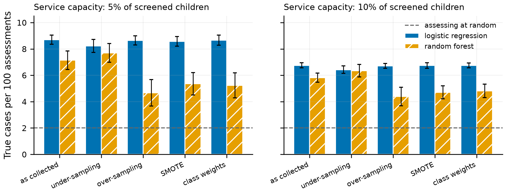

**Authors:** [Author 1]^1,\*^, [Author 2]^1^, [Author 3]^2^

^1^ Faculty of Information Technology, Lac Hong University, Bien Hoa, Dong Nai, Viet Nam

^2^ [Affiliation — a child clinical psychologist co-author is recommended]

^\*^ Corresponding author: [e-mail]

**Running head:** REBALANCED SCREENING TOOLS IN PSYCHOLOGICAL SERVICES

# ABSTRACT

Digital developmental screening tools are often trained on "rebalanced" data — under-sampling, over-sampling, SMOTE or class weights — because affected children are a small minority. We asked what this technical choice does to the two things a child psychological service actually uses: the risk figure communicated to families and the list of children referred for specialist assessment. Using synthetic parent-report data generated from a 20-item questionnaire covering six developmental domains ({{POOL_POS}} positive and {{POOL_NEG}} negative records), a community prevalence of 2%, logistic regression and random forest, five training strategies, {{NREP}} replications and a fixed population of {{NEVAL}} children, we found that training after SMOTE raised the mean predicted risk of logistic regression to {{T3:LR|SMOTE|raw|mean_p|d3}} ({{INFL_LR_SMOTE}} times the true rate) and placed {{T1:LR|SMOTE|raw|>=20%|share|p1}} of children in a "20% or higher" band in which only {{T1:LR|SMOTE|raw|>=20%|obs|k0}} per 1,000 were affected; a "refer at 5% risk" rule then referred virtually every child. When the service admitted a fixed 5% of children with the highest scores, rebalancing did not help logistic regression and reduced the yield of random forest from {{T2:RF|N0|cap|0.05|ppv|c1}} to {{T2:RF|SMOTE|cap|0.05|ppv|c1}} true cases per 100 assessments, with under-sampling the only exception. Two label-free repairs — analytical prior correction and "mean matching" to a known prevalence — almost fully restored logistic regression (expected calibration error {{LR_MM_ECE_MIN}}–{{LR_MM_ECE_MAX}} per 1,000) but not random forest after over-sampling, SMOTE or class weighting, whose risk scale was distorted in shape (calibration slope {{RF_SLOPE_MIN}}–{{RF_SLOPE_MAX}}). Updating on 100–200 local labelled records was worse than mean matching to a known prevalence. We propose six questions a psychological service should ask a tool vendor and release an open-source audit tool. All findings come from synthetic data and require field validation.

**Keywords:** child clinical psychology; digital decision support; class imbalance; risk communication; service capacity.

**Public significance statement.** Screening apps are often built with data "rebalancing" tricks that make the risk numbers they display many times too high. In a simulation, this made most families hear an alarming risk figure and sent almost every screened child to the assessment waiting list, without finding more affected children. A simple check on the tool's output can detect and often repair the problem before the tool is used.

# 1. INTRODUCTION

## 1.1. Digital tools in the child psychological care pathway

Developmental screening is the entry point of a care pathway: a questionnaire is completed in the community or in primary care, children with concerning results are referred to a psychologist or a multidisciplinary team for specialist assessment, and only after that assessment is a diagnosis made and an intervention planned [@hyman2020]. In Viet Nam, a national toolkit for the early detection of autism spectrum disorder has been issued by the Ministry of Health [@byt2021], and digital applications increasingly score the questionnaires, store them and suggest referrals. In psychology, this sits within the broader movement towards measurement-based care and digital mental health [@lewis2019; @torous2021]: tools do not replace clinicians but inform their decisions, and structured prediction has long been known to be at least as accurate as unaided judgement [@grove2000]. A decision-support system is useful, however, only if its output is read as what it is [@sutton2020].

The output of a screening tool is used in two ways that demand two different qualities. The first is **talking to families**: a psychologist or health worker reads out a number or a risk band, and parents understand it as the probability that their child has a disorder. Communicating risk well is an evidence-based clinical skill [@zipkin2014; @spiegelhalter2017], and it is possible only if the number on the screen really is a probability — that is, if it is **calibrated** [@vancalster2019]. The second is **ordering the waiting list**: a psychological service has limited assessment capacity, and the tool decides who is seen first. This mainly requires the tool to **rank** children correctly and — if referral is decided by a risk threshold — requires that threshold to mean what it says, so that the number of referrals matches what the service can absorb.

## 1.2. Class imbalance and the habit of rebalancing

About 1% of children in the community are autistic [@zeidan2022], and screen-positive rates of parent questionnaires are a few per cent [@robins2014; @aishworiya2023]. Machine-learning texts call this **class imbalance**, and the common reflex is to rebalance the training set: under-sample the majority class, over-sample the minority class, create synthetic minority cases with SMOTE [@chawla2002], or give the minority class a larger weight [@he2009; @fernandez2018]. A recent field study of 3,639 Vietnamese toddlers screened with the Vietnamese M-CHAT-R reported a random forest trained with SMOTE that reached an AUC of 0.983 but a precision of only 0.351 at a prevalence of about 2% [@vo2026] — an illustration that an excellent ranking statistic can coexist with a substantial false-alarm rate.

Methodological work has shown that imbalance "corrections" damage probability calibration while rarely improving discrimination, both for logistic regression [@vandengoorbergh2022] and for machine-learning models [@carriero2025]. In theory, rebalancing is equivalent to changing the prior class probability and can be undone with Bayes' rule when the original prior is known [@elkan2001; @saerens2002; @dalpozzolo2015]. These results, however, are written in the language of statisticians — Brier scores, calibration slopes, AUC — not in the language of a psychological service: how many families will hear an inflated risk figure, how much longer the waiting list will be, and how many affected children will not be prioritised. When a hospital or an early-intervention centre buys or receives a tool, it usually has no control over how the tool was trained; it only sees the output. The practical question is therefore: **from the output alone, can a service recognise and repair the consequences of rebalancing?**

## 1.3. Aims

This simulation study answers three questions, set in a psychological service that receives children from community screening at a prevalence of 2%:

1. **The figure told to families.** How does rebalancing the training data change the share of children placed in each risk band, and is the band still truthful?
2. **The waiting list.** When the service admits children up to a fixed capacity, does rebalancing find more affected children? When it admits children above a risk threshold, how many are referred and how does the net benefit of the decision change?
3. **Checking and repairing before use.** When the vendor has rebalanced, can the service repair the risk scale with no — or few — local labelled records, and when is repair impossible?

A fuller grid (seven imbalance strategies × four models × four prevalences) is reported separately for a methodological audience [@nhom2026en; @nhom2026vn]; here we summarise that grid briefly (Section 3.1) and focus on three new analyses aimed at clinical users.

# 2. METHOD

The simulation is described following the ADEMP structure (aims, data-generating mechanisms, estimands, methods, performance measures) [@morris2019], and reporting follows the relevant items of TRIPOD+AI [@collins2024]. **No data from real children were used**, so ethical approval was not required.

## 2.1. Synthetic data

Data were produced with the simulator of a hybrid rule-based/machine-learning screening system under development [@nguyen2026]. The generator simulates parents' answers to a 20-item questionnaire covering six developmental domains (communication–language, gross motor, fine motor, imitation–learning, personal–social, atypical behaviour), including item non-response and response noise. Each record is summarised into six domain risk scores on a 0–1 scale by the system's fuzzy inference layer; these six scores are the model inputs. We generated a positive pool ({{POOL_POS_RAW}} records) and a negative pool ({{POOL_NEG_RAW}} records) separately; after removing records with more than 30% missing items or a missing domain score, following the tool's own rejection rule, {{POOL_POS}} and {{POOL_NEG}} records remained. Each pool was split once into a **development** half (for training: {{DEV_POS}} positive, {{DEV_NEG}} negative) and a **deployment** half (for evaluation). Because the generator uses prevalence only when assigning the label, resampling the two pools at any rate reproduces the population distribution at that prevalence. The pools are identical to those of the companion study (SHA-256 fingerprint `{{POOLSHA}}…`).

**Deployment population.** From the deployment half we drew, once, a population of {{NEVAL}} children with exactly {{NEVAL_POS}} affected children (2%), playing the role of all children screened in one catchment area in one year. The remainder of the deployment half ({{AUD_POS}} positive, {{AUD_NEG}} negative) was used only to draw the **labelled audit samples** of Section 2.5, so no record was used both to repair the scale and to evaluate it.

## 2.2. Models and five training strategies

In each replication a training set of {{NTRAIN}} records at 2% prevalence (100 affected children) was drawn from the development half. Two models common in the machine-learning screening literature were trained: **logistic regression** (L2 penalty, C = 1) and **random forest** [@breiman2001] (200 trees, at least five records per leaf). Each model was trained in five ways: (i) **as collected**; (ii) **under-sampling** — randomly discarding unaffected children until both classes were equal (100 + 100 records); (iii) **over-sampling** — randomly duplicating affected children until both classes were equal; (iv) **SMOTE** — generating synthetic affected children by interpolating towards one of their five nearest same-class neighbours [@chawla2002]; (v) **class weights** — giving both classes equal total weight. The last four raise the effective share of the affected class in training to 50%.

## 2.3. Two ways of running a service

**Capacity-based.** The service can assess only K% of screened children (K = 2, 5 or 10%) and admits the K% with the highest scores. This uses only the **ranking** and is therefore independent of the risk scale. The outcome is the **number of true cases per 100 assessments** (positive predictive value at capacity K), together with sensitivity — the share of affected children who make the list. When several children share the score at the capacity boundary, we used the expectation of a random draw within the tie. The reference is assessing at random: two true cases per 100 assessments.

**Threshold-based.** A child is referred when the displayed risk is at least $p_t$, $p_t \in \{2, 5, 10\%\}$. The threshold encodes the trade-off the service accepts: $p_t = 5\%$ means accepting at most 19 assessments of unaffected children to find one affected child [@wynants2019]. We report the share of children referred — a direct measure of the **load** on the waiting list — and the net benefit of decision curve analysis [@vickers2006; @vickers2016]:

$$\mathrm{NB}(p_t) = \frac{\mathrm{TP}}{n} - \frac{\mathrm{FP}}{n} \cdot \frac{p_t}{1 - p_t}, \qquad (1)$$

where TP and FP are the numbers of referred children with and without the disorder and $n$ the number screened. The two reference strategies are "refer none" (NB = 0) and "refer all" (NB = $\pi - (1-\pi)\,p_t/(1-p_t)$ with $\pi = 0.02$; exactly 0 at $p_t = 2\%$). A rule is useful at $p_t$ only if its net benefit exceeds both references.

## 2.4. The figure told to families

To mimic how results are discussed, risk was grouped into four bands — below 1%, 1–5%, 5–20% and 20% or higher — an illustrative convention of this study, not a clinical standard. For each training strategy we recorded the share of children in each band and the true rate of the disorder within the band, expressed as natural frequencies ("per 1,000 children"), which both professionals and families understand better than conditional probabilities [@gigerenzer1995]. A band is truthful if the number of affected children per 1,000 lies within the range its label promises.

## 2.5. Checking and repairing the scale before deployment

We assumed that the service receives a trained model and compared five ways of handling its output $p$. Let $\sigma(z) = 1/(1+e^{-z})$ and $\mathrm{logit}(p) = \ln[p/(1-p)]$.

(a) **Raw output** of the model.

(b) **Prior correction** [@elkan2001; @saerens2002]. If the vendor discloses the original training prevalence $\pi$ and the prevalence after rebalancing $\pi_s$ (here 0.5), the probability is mapped back with Bayes' rule

$$p' = \frac{p\,\pi/\pi_s}{p\,\pi/\pi_s + (1-p)(1-\pi)/(1-\pi_s)}. \qquad (2)$$

Equation (2) is exact when rebalancing only shifts the prior and the model estimates the conditional probability correctly under $\pi_s$. It needs no labels but needs information that vendors rarely publish.

(c) **Mean matching** (no labels and no vendor information). The service runs the tool on its own population (without knowing who is affected) and chooses a log-odds shift $\delta$ so that the mean risk equals the prevalence $\hat\pi$ it estimates from epidemiological data:

$$\frac{1}{n}\sum_{i=1}^{n} \sigma\big(\mathrm{logit}(p_i) + \delta\big) = \hat\pi, \qquad p_i' = \sigma\big(\mathrm{logit}(p_i) + \delta\big). \qquad (3)$$

To measure the cost of a wrong prevalence estimate we used $\hat\pi$ = 2% (correct), 1% and 4% (wrong by a factor of two in either direction).

(d) **Intercept update** on $n$ local labelled records [@steyerberg2004; @janssen2008]: as (3), but $\delta$ is chosen so that the summed risk equals the number of affected children observed in the sample — which is exactly the maximum-likelihood estimate of the intercept with the slope held fixed.

(e) **Platt refit** on the same $n$ records: logistic regression of the label on $\mathrm{logit}(p)$ (default L2 penalty), re-estimating both intercept and slope.

Labelled samples of $n \in \{100, 200, 500\}$ records were drawn from the reserved part of the deployment half, with a binomial number of affected children (mean {{NPOS_100}}, {{NPOS_200}} and {{NPOS_500}}), as when a service takes $n$ consecutive records with a completed specialist assessment. Repairs (b)–(d) are strictly increasing transformations and **do not change the ranking**; capacity-based results are therefore independent of the repair.

## 2.6. Measures and statistical analysis

**Mean risk** versus the true prevalence measures calibration-in-the-large, the lowest level of the calibration hierarchy [@vancalster2016]. The **expected calibration error** (ECE) splits the population into ten groups by quantiles of risk and averages, weighted by group size, the absolute difference between mean risk and observed rate. The **calibration slope** is the coefficient of $\mathrm{logit}(p)$ in an unpenalised logistic regression of the label on $\mathrm{logit}(p)$; 1 is ideal, and values below 1 mean the risks are **too extreme** (too high for high scorers and too low for low scorers) — a distortion of **shape** that no shift can repair. The **Brier score** [@brier1950] and the PR-AUC (area under the precision–recall curve) are used in the main grid.

All measures are means over {{NREP}} replications; each replication redraws the training set and the labelled samples, while the deployment population is fixed. For each model, every training strategy (and every repair) was compared with training as collected using paired per-replication differences and a one-sample t-test. The family of {{NTESTS_TL}} comparisons (true cases per 100 assessments at three capacities; net benefit of the raw output, after prior correction and after mean matching at three thresholds) was adjusted with the Benjamini–Hochberg procedure at a false discovery rate of 0.05 [@benjamini1995]; the family keeps six trivial comparisons (prior correction of the as-collected model is the identity), which makes the procedure slightly conservative. Random seeds are fixed and logged together with source-code fingerprints; re-running reproduces the result files byte for byte (Data and code availability).

## 2.7. Output-audit tool

From the results of Section 2.5 we wrote a command-line tool that depends only on numpy. Its input is a CSV file of the screening tool's scores for local children (with or without labels), the estimated prevalence and the service capacity. It reports: (1) the **inflation factor** — mean risk divided by prevalence, with a warning above 1.5; (2) the share of children referred at each threshold, compared with capacity; (3) the score cut-off matching capacity and the number of children tied at the boundary; (4) the scale after mean matching (or prior correction if the vendor disclosed the training prevalences) with a before–after table of risk bands; and (5) with labels, the observed rate with a 95% Wilson interval, the calibration slope (only with at least ten affected children) and net benefit before and after. The warning thresholds are conventions derived from the simulation, not clinical standards.

# 3. RESULTS

## 3.1. Main grid: rebalancing rarely helps discrimination and always damages probabilities

Table 1 summarises the main grid of the companion study at 2% prevalence ({{G_NREP}} replications, a test set of {{G_NTEST}} records per prevalence; {{G_NCONF}} configurations and {{G_NTESTS}} Benjamini–Hochberg-adjusted tests). Across four prevalences and four models, the four rebalancing strategies worsened the Brier score significantly in {{G_BRIER_WORSE}} cells. PR-AUC improved significantly in only {{G_PR_UP}} cells — all involving fuzzy k-NN (a model with almost no discrimination on these data) or random forest with under-sampling, the largest gain being {{G_PR_UP_MAX}} per 1,000 — and deteriorated significantly in {{G_PR_DOWN}}. Net benefit at the 2% threshold fell significantly in {{G_NB_DOWN}}/{{G_NB_N}} cells and rose in {{G_NB_UP}}, mostly for fuzzy k-NN and at 5% prevalence, where "refer all" is already a good strategy at a 2% threshold. Logistic regression and the hybrid model trained after rebalancing flagged almost every child at all four prevalences.

**Table 1.** *Main grid at 2% prevalence: PR-AUC, Brier score, share of children referred and net benefit under the rule "refer when risk ≥ 2%". Threshold moving uses exactly the as-collected model and only re-selects the cut-off on a 2,000-record calibration set, so its PR-AUC and Brier score equal those of the as-collected model by construction. Means over {{G_NREP}} replications. Reference values: the Brier score of a constant forecast of 0.02 is 19.6 per 1,000; the PR-AUC of a random forecast is 20 per 1,000.*

{{TABLE1}}

The rest of the Results focuses on logistic regression and random forest — the two models with real discrimination (AUC about {{G:0.02|RF|N0|roc_auc|d2}}–{{G:0.02|LR|N0|roc_auc|d2}}) and the most common in practice.

## 3.2. The figure told to families

Rebalancing multiplied the mean risk of logistic regression by {{INFL_LR_RUS}} (under-sampling), {{INFL_LR_ROS}} (over-sampling), {{INFL_LR_SMOTE}} (SMOTE) and {{INFL_LR_CW}} (class weights) relative to the true prevalence; for random forest the factors were {{INFL_RF_RUS}}, {{INFL_RF_ROS}}, {{INFL_RF_SMOTE}} and {{INFL_RF_CW}}. Table 2 and Figure 1 translate this into the language of counselling.

**Table 2.** *Logistic regression at 2% prevalence: children per 1,000 placed in each risk band and children per 1,000 in that band who are truly affected. Means over {{NREP}} replications in a population of {{NEVAL}} children; "—": no child in the band.*

{{TABLE2}}

{width=16cm}

As collected, the bands were truthful: of 1,000 children told "1–5%", about {{T1:LR|N0|raw|1-5%|obs|k0}} were affected, and of 1,000 in the "5–20%" band, about {{T1:LR|N0|raw|5-20%|obs|k0}}. After SMOTE, {{LR_SM_HI_1000}} of every 1,000 screened children were told "20% or higher", yet the true rate in that group ({{T1:LR|SMOTE|raw|>=20%|obs|k0}} per 1,000) was almost the community prevalence. The "high" band no longer carried information about the individual child, but it still carried an alarming message to the family. Mean matching to 2% (last columns) restored a band distribution close to the as-collected one.

## 3.3. Capacity-based service: rebalancing does not find more true cases

When the service admitted the top K% of children, logistic regression trained as collected found {{T2:LR|N0|cap|0.05|ppv|c2}} true cases per 100 assessments at K = 5% — {{LIFT_LR_5}} times the yield of assessing at random (Table 3, Figure 2). Over-sampling, SMOTE and class weights did not change this significantly ({{LR_CAP_NS}} comparisons non-significant after adjustment); under-sampling reduced it slightly but significantly (q ≤ {{Q_LR_RUS_CAP}}), because the model then learns from only 200 records. For random forest, over-sampling, SMOTE and class weights **reduced** the number of true cases per 100 assessments at every capacity ({{RF_CAP_SIG}} comparisons significant), by {{RF_CAP5_LOSS_MIN}} to {{RF_CAP5_LOSS_MAX}} cases at K = 5%. Scaled to 10,000 screened children and the same 500 assessments, SMOTE made the service miss about {{RF_CAP5_MISSED}} additional affected children. The only exception was under-sampling with random forest, which increased the yield from {{T2:RF|N0|cap|0.05|ppv|c2}} to {{T2:RF|RUS|cap|0.05|ppv|c2}} cases at K = 5% (q = {{Q_RF_RUS_CAP5}}): each tree learns from a small, balanced set and the forest memorises less — a regularisation effect rather than a benefit of "balance" as such.

**Table 3.** *True cases per 100 assessments (mean ± SD over {{NREP}} replications) when the service admits the K% of children with the highest scores, and sensitivity at K = 5%. \*: differs from training as collected after Benjamini–Hochberg adjustment. Reference: assessing at random yields 2 true cases per 100.*

{{TABLE3}}

{width=16cm}

## 3.4. Threshold-based service: the waiting list explodes

Table 4 and Figure 3 show what happens when the service applies a risk threshold to the probabilities output by the tool. For logistic regression trained after any rebalancing strategy, at least {{LR_REFER_MIN}} of children were referred at the 2% and 5% thresholds: the rule degenerated into "refer all", with exactly that strategy's net benefit ({{NB_ALL_5}} per 1,000 at 5%, worse than referring no one). At the 10% threshold, logistic regression after SMOTE still referred {{T2:LR|SMOTE|raw|0.1|refer|p1}} of children. A service with 5% capacity would receive a list about twenty times its capacity. Random forest after SMOTE referred {{T2:RF|SMOTE|raw|0.05|refer|p1}} of children at the 5% threshold, with a net benefit of {{T2:RF|SMOTE|raw|0.05|nb|k2}} per 1,000 versus {{T2:RF|N0|raw|0.05|nb|k2}} for the as-collected model.

**Table 4.** *Share of children referred · net benefit ×1,000 under the rule "refer when risk ≥ p~t~", 2% prevalence. Means over {{NREP}} replications. A net benefit that is positive and above that of "refer all" means the rule is useful at that threshold.*

{{TABLE4}}

{width=16cm}

## 3.5. Repairing the scale before use: possible for logistic regression, not for random forest

Table 5 compares ways of handling the output of both models trained after SMOTE.

**Table 5.** *Repairing models trained after SMOTE, 2% prevalence: mean risk (true value 0.0200), ECE (mean ± SD over {{NREP}} replications), calibration slope (ideal 1; not reported for Platt refits because it is unstable when the fitted coefficient is close to 0), share referred and net benefit at the 5% threshold. The last row for each model is training as collected, raw output.*

{{TABLE5}}

**Logistic regression: repairable without labels.** For logistic regression, rebalancing mainly shifted the intercept: the calibration slope stayed close to 1 under every training strategy ({{LR_SLOPE_MIN}}–{{LR_SLOPE_MAX}}), so the scale was shifted rather than stretched. Prior correction brought the ECE down to {{LR_PC_ECE_MIN}}–{{LR_PC_ECE_MAX}} per 1,000 and mean matching to {{LR_MM_ECE_MIN}}–{{LR_MM_ECE_MAX}} per 1,000 for all four rebalancing strategies, and the net benefit after either repair differed from the as-collected model by at most {{LR_REPAIR_MAXDIFF}} per 1,000 at all three thresholds — far smaller than the decisions discussed here, even though a few tiny differences were statistically significant thanks to the paired design.

**Random forest: not repairable by a shift.** After over-sampling, SMOTE and class weights, the calibration slope of random forest fell to {{RF_SLOPE_MIN}}–{{RF_SLOPE_MAX}} (versus {{RF_N0_SLOPE}} for the as-collected model, itself already too extreme): trees memorise duplicated or interpolated affected children, so probabilities are stretched as well as shifted. Prior correction then **over-corrects**: mean risk fell to {{T3:RF|SMOTE|pc|mean_p|d4}}, only {{T2:RF|SMOTE|pc|0.02|refer|p1}} of children were referred at the 2% threshold and the net benefit was {{T2:RF|SMOTE|pc|0.02|nb|k2}} versus {{T2:RF|N0|raw|0.02|nb|k2}} per 1,000 for the as-collected model. Mean matching restored a mean risk of exactly 0.0200 but not the shape: the ECE remained {{RF_MM_ECE_MIN}}–{{RF_MM_ECE_MAX}} per 1,000 and net benefit at the 5% threshold was negative. A notable exception was random forest with **under-sampling**: its slope was {{T3:RF|RUS|raw|slope|d2}}, and after prior correction its net benefit at the 2% threshold was {{T2:RF|RUS|pc|0.02|nb|k2}} per 1,000 — significantly above the as-collected model, in line with {@dalpozzolo2015}.

**A wrong prevalence estimate.** Mean matching needs a prevalence estimate. For logistic regression after SMOTE, using 4% instead of 2% raised the share referred at the 5% threshold to {{T2:LR|SMOTE|mm_0.04|0.05|refer|p1}} and made net benefit negative ({{T2:LR|SMOTE|mm_0.04|0.05|nb|k2}}); using 1% lowered the share referred to {{T2:LR|SMOTE|mm_0.01|0.05|refer|p1}} with a net benefit of {{T2:LR|SMOTE|mm_0.01|0.05|nb|k2}} (versus {{T2:LR|SMOTE|mm_0.02|0.05|nb|k2}} with the correct prevalence). At thresholds of 5% and above, under-estimating the prevalence was less harmful than over-estimating it.

**A few local labels are not better than a trustworthy prevalence.** For logistic regression after SMOTE, an intercept update on 100 or 200 labelled records — only about {{NPOS_100}} and {{NPOS_200}} affected children — gave an ECE of {{T3:LR|SMOTE|icpt_100|ece|k1}} and {{T3:LR|SMOTE|icpt_200|ece|k1}} per 1,000, worse than mean matching to the correct prevalence ({{T3:LR|SMOTE|mm_0.02|ece|k1}}), because the number of affected children in a small sample fluctuates strongly. For logistic regression, a full Platt refit was worse still and unstable: the fitted Platt slope was negative — so the repair **reversed** the ranking — in {{PLATT_NEG_100}} fits with n = 100, {{PLATT_NEG_200}} with n = 200 and {{PLATT_NEG_500}} with n = 500; with n = 100, {{SKIP_100}} replications contained no affected child and could not be fitted. With 500 records (about {{NPOS_500}} affected children) the intercept update narrowed the gap ({{T3:LR|SMOTE|icpt_500|ece|k1}} per 1,000) but did not yet match mean matching to the correct prevalence. For random forest after SMOTE, a Platt refit on 500 records was the only option in Table 5 that repaired most of the shape distortion (ECE {{T3:RF|SMOTE|platt_500|ece|k1}} per 1,000), but its net benefit at the 5% threshold was still only {{T2:RF|SMOTE|platt_500|0.05|nb|k2}} versus {{T2:RF|N0|raw|0.05|nb|k2}} for the as-collected model: recalibration cannot restore the ranking lost in Section 3.3.

## 3.6. The audit tool on three hypothetical vendors

We ran the tool of Section 2.7 on three hypothetical models with a service capacity of 5%. **Vendor A** (logistic regression after SMOTE; the service has only 5,000 unlabelled scores): the tool reported an inflation factor of {{DA_INFL}} and a referral share of {{DA_REF5}} at the 5% threshold (above capacity), falling to {{DA_REF5_AFTER}} after mean matching; the number of children per 1,000 in the "20% or higher" band fell from {{DA_HI_BEFORE}} to {{DA_HI_AFTER}}. **Vendor B** (random forest after SMOTE; 1,000 labelled records with {{DB_NPOS}} affected children): inflation factor {{DB_INFL}}; after mean matching the net benefit at the 5% threshold rose from {{DB_NB5_BEFORE}} to {{DB_NB5_AFTER}} per 1,000, but the calibration slope was only {{DB_SLOPE}} and the tool warned of a shape distortion — that is, the service should ask for a model that was not rebalanced. **Vendor C** (logistic regression trained as collected; the same 1,000 labelled records): inflation factor {{DC_INFL}}, slope {{DC_SLOPE}}, and the expected 2% prevalence lay inside the Wilson interval {{DC_LO}}–{{DC_HI}}; the only warning was that the 5% threshold referred {{DC_REF5}} of children, above the 5% capacity — a threshold decision the service must make, not a defect of the tool.

# 4. DISCUSSION

## 4.1. Implications for psychological services

The results can be summarised in one sentence: **rebalancing the training data is a technical decision of the developer, but its consequences land in the counselling room and on the waiting list.** Three consequences stand out.

*First, the figure told to families loses its meaning.* A tool trained after SMOTE put most children in a "high" risk band and none in the low bands (Table 2). If that figure is read out to parents, most families leave with a level of worry that does not match the real risk — a psychological harm that guidance on risk communication tries to prevent [@zipkin2014; @spiegelhalter2017]. Conversely, when almost every child is flagged, the alert loses its force for professionals too — the alert fatigue described for clinical decision-support systems [@ancker2017].

*Second, the waiting list is set by the risk scale rather than by capacity.* If the service applies a risk threshold to the output of a rebalanced model, referrals can exceed capacity many times over (Table 4). In practice this rarely leads to assessing everyone; it leads to long queues, first-come-first-served ordering instead of risk-based ordering, and the loss of the very benefit the tool was bought to deliver.

*Third, rebalancing does not buy more true cases.* When the service admits children up to capacity — the only mode of operation that does not depend on the scale — rebalancing did not help logistic regression and made random forest worse, except under-sampling (Table 3). The belief that rebalancing "makes the model more sensitive to the minority class" confuses **sensitivity at a default cut-off of 0.5** with **ranking ability**: for logistic regression, rebalancing essentially moves the cut-off — something the service can do directly by choosing a threshold or a capacity; for random forest it also damages the ranking itself.

We therefore propose six questions a psychological service should put to a vendor before deployment (Table 6). They do not require psychologists to understand the algorithm; they require vendors to be transparent about what was done to the data, and they let the service check the answers itself with the tool of Section 2.7.

**Table 6.** *Six questions a psychological service should ask the vendor of a screening tool, and how to use the answers.*

| Question | Why ask | If the answer is… |
|:------------------------------|:------------------------------|:------------------------------|
| 1\. Was the model trained on rebalanced data (under- or over-sampling, SMOTE, class weights)? | Rebalancing inflates every probability (Section 3.2). | "Yes": do not read probabilities to families before repairing the scale. |
| 2\. What were the prevalences in the original training data and after rebalancing? | Needed for prior correction, Equation (2). | Unknown: use mean matching, Equation (3). |
| 3\. What kind of model is it? | Logistic regression can be repaired by a shift; random forest after over-sampling, SMOTE or class weights cannot (Section 3.5). | A tree ensemble after over-sampling, SMOTE or class weights: ask for a version that was not rebalanced, or for under-sampling with prior correction. |
| 4\. At what prevalence was calibration checked? | Community prevalence differs from that of the development sample. | Not at community prevalence: run the audit tool on the service's own unlabelled scores. |
| 5\. What is the default referral threshold, and what share of children does it refer? | Referral load must match assessment capacity. | Above capacity: choose another threshold, or run the service by capacity (admit the top K%). |
| 6\. Are local labels needed, and how many? | With fewer than a few hundred labelled records, updating is worse than a trustworthy prevalence (Section 3.5). | Prefer a trustworthy prevalence estimate; consider refitting only with about 500 records and at least 10 affected children. |

## 4.2. Why logistic regression can be repaired and random forest cannot

For a model that estimates the conditional probability correctly, rebalancing the training set only changes the prior; on the log-odds scale this adds a constant, and Equation (2) or (3) subtracts that constant again [@elkan2001; @saerens2002]. Logistic regression is close to this ideal: class weights and over-sampling change little besides the intercept. Random forest is not. Over-sampling and SMOTE place many copies or near-copies of the same affected children in the training set; leaves become "pure" around those points, and the forest's probabilities are pushed towards the extremes. This is a distortion of **shape**, visible as a calibration slope far from 1, and no monotone shift — not even Bayes' rule, correct in theory — can repair it; prior correction even over-corrects, because its assumption is violated. These findings agree with the simulations of {@vandengoorbergh2022} for logistic regression and {@carriero2025} for machine-learning models, and with the recommendation of {@dalpozzolo2015} to combine under-sampling with prior correction for tree-based models.

## 4.3. Context

The Vietnamese field study [@vo2026] reported a very high AUC for random forest with SMOTE; this simulation does not contradict that result — the data and models differ — but suggests that when such a model enters a service, the share of children referred, the net benefit at the threshold the service actually uses, and calibration at community prevalence should be reported as well. The same lesson comes from the M-CHAT-R/F, whose pooled positive predictive value in community samples is considerably lower than in high-prevalence samples [@aishworiya2023]. A companion study on probability calibration [@nhom2026p9] showed that the scores of a fuzzy inference system are not probabilities either; the present study adds a different source of distortion, one that can affect any machine-learning model and that is created by the training procedure itself.

## 4.4. Limitations

First, all results come from **synthetic data**: the mechanical phenomena (inflation, degeneration into "refer all", exact prior correction for regression-type models) do not depend on the generator, but specific magnitudes — true cases per 100 assessments, the size of the random-forest loss — depend on the structure of the simulated data and may differ in real children. Second, both models discriminate only moderately on these data (AUC about {{G:0.02|RF|N0|roc_auc|d2}}–{{G:0.02|LR|N0|roc_auc|d2}}); with better-discriminating models the gaps between modes of operation may differ. Third, the three new analyses consider one prevalence (2%) and two models; the full grid of the companion study covers four prevalences and four models. Fourth, hyperparameters were fixed (200 trees, five records per leaf); a more strongly regularised random forest may be less extreme. Fifth, labels in the audit samples were assumed to be error-free specialist assessments; in practice labels have error and are usually available only for referred children (verification bias), which makes updating on local labels even harder than simulated. Sixth, the four risk bands, the capacity levels and the tool's warning thresholds are illustrative conventions; a given service should substitute its own. Finally, the study did not measure psychological effects on families; the arguments about worry and alert fatigue rest on the literature, not on data from this study.

# 5. CONCLUSION

On synthetic data at 2% prevalence, training a screening tool on rebalanced data did not help a psychological service find more affected children, but it inflated the risk figure told to families more than twentyfold and made a threshold-based referral rule send almost every child to the waiting list. For logistic regression the service can repair this almost completely with a label-free log-odds shift, given only a trustworthy prevalence estimate; for random forest after over-sampling, SMOTE or class weights it cannot, and a version without rebalancing should be requested. In practice: ask the vendor the six questions of Table 6, check the inflation factor and referral load on the service's own population before deployment, and, where possible, run the service by capacity rather than by an unchecked probability threshold. These conclusions need to be verified on real screening data before they are applied.

# DECLARATIONS

**Ethics.** The study used only machine-generated synthetic data; no data from any child or family were involved, so ethical review was not required.

**Data and code availability.** All code, the synthetic record pools (`_p11_pool.npz`), result files, the audit tool and the manuscript build scripts are available at [GitHub link — to be added after upload]. `python src/run_p11_tl.py` reproduces every number in Sections 3.2–3.5 (about 10 minutes); `python src/p11_referral_audit.py --demo` reproduces Section 3.6. Two runs produce byte-identical result files.

**Related publications.** The main grid in Section 3.1 and Table 1 is reported in full in two companion manuscripts by the same authors [@nhom2026en; @nhom2026vn]; the analyses in Sections 3.2–3.6, Tables 2–6 and Figures 1–3 are new. A Vietnamese-language version of this article, sharing its data and results, has been prepared for a national journal; the relationship between the manuscripts will be disclosed to the editors.

**Conflicts of interest.** The authors declare no conflicts of interest.

**Funding.** [To be completed.]

**Author contributions.** [To be completed following CRediT.]

# REFERENCES

{{REFERENCES}}
